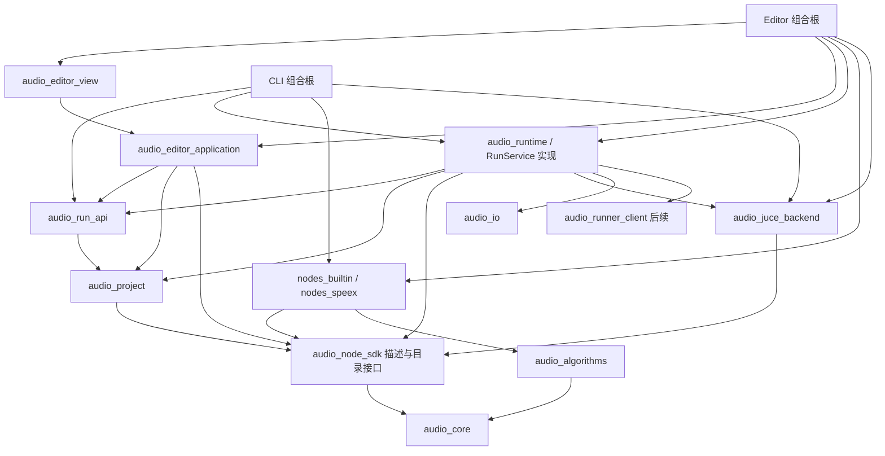

# 算法与编辑器分离重构方案

2026-10-22执行修订：[交付收口补充约束](plan_delivery_convergence.md)调整当前顺序与验证节奏，并把用户C++节点独立编译/启动加载转为首版必需。内置静态节点与算法库导出继续保留，不能替代新增UPN验收。原R0～R6/110个AR及G/NED要求不删除；下文旧阶段表为需求归属，实际交付顺序按补充约束P0～P4。

## 1. 定位与完成定义

本方案基于当前源码及 `build/reports/architecture/20261018/assessment.md`。这是待实施的重构契约，文中的新增类、目录、target、测试与能力均不能视为已实现。保持原平台 G0～G6 和节点交互专项验收要求，不用重构阶段通过替代平台通过。

执行配套文档依次为[本开发方案](plan_architecture_refactor.md)、[测试与通过准则](testing_architecture_refactor.md)、[Agent TDD与Loop Engineering规程](agent_loop_architecture_refactor.md)。用户已授权后续Agent按规划直接修改代码、验证、自迭代，常规技术决策与阶段推进无需确认；遵守实际工具权限，不自动提交、推送、发布、购买或覆盖用户音频。本文的ready状态只表示方案可以实施。

2026-10-18当前任务顺序采用本方案R0～R6；历史主文档/节点专项中“先完成NI再推进”的顺序不阻止独立重构。原交互语义、G0/G1缺项和NED全部必需证据继续保留；涉及相应组件时先读专项文档并执行回归。

目标是保留已有 Gain 闭环，逐步形成：独立算法库 → 节点适配 → 通用运行服务 → 应用控制 → 编辑展示。编辑器通过运行服务间接使用算法库；算法库同时可供独立 C++ 程序直接调用。编辑器控件不包含具体算法头文件，也不按算法 type_id 决定执行与参数编辑行为。

完成基本重构须同时满足：

1. GUI、CLI、独立调用的 Gain 共用同一算法实现。
2. 加入一个全新的 C++ ChannelSwap 节点，只增加算法、插件适配/描述、组合注册、构建、测试与示例；通用画布、参数面板、编译器和调度器代码不变。
3. 参数修改、拓扑修改与结果接收通过无 JUCE 控件依赖的应用控制层。
4. 纯算法可在不获取 JUCE、不构建编辑器、不初始化消息线程/设备的构建中使用。
5. 新增 bool/int/float/enum/string/path 参数通过描述生成控件；未实现的参数结构明确不可编辑，不回退到具体算法特判。
6. 旧 Gain 工程可打开、保存、重新运行，结果满足既有独立数值 oracle；实际拖放、保存、播放证据仍单独取得。

## 2. 目标依赖

箭头表示编译或接口依赖，省略向 core 的公共依赖：



不把静态插件 target 反向链接进 SDK 或 backend。组合根链接具体插件并向 registry 注册构造器，backend 只接收 SDK processor。UI 只拿只读目录接口，不拿可构造执行对象的工厂接口。

| 模块 | 负责 | 禁止承担 |
| --- | --- | --- |
| audio_core | 音频视图/格式/区间、诊断、产物基础类型 | JUCE、项目模型、算法枚举 |
| audio_algorithms | 具体算法、强类型配置、状态与数值处理 | 节点 ID、JSON 参数、工程路径、控件、JUCE processor |
| audio_node_sdk | 描述、参数校验契约、端口、原生处理器生命周期、注册接口 | 内置 Gain 描述、具体算法实现、GUI |
| nodes_* | 算法与节点规则之间的薄适配，描述与工厂的成对注册 | 画布、UI 线程、通用调度策略 |
| audio_project | 图、命令、历史、参数/拓扑验证、版本 | JUCE 图、执行实例 |
| audio_run_api | 请求/事件/结果、取消句柄和服务接口 | JuceProcessorRegistry、控件、具体 backend 类型 |
| audio_runtime | 冻结快照、编译任务、调度、产物发布与诊断 | 算法 type_id 分支、控件、直接读实时可变工程 |
| audio_juce_backend | 统一原生 wrapper、总线映射、FIFO/延迟适配、JUCE 渲染 | Gain/Speex 数值实现、Python 调用 |
| audio_editor_application | 当前工程、选择、命令分派、运行身份与状态、结果接收 | Component/Slider、AudioDeviceManager、算法调用 |
| audio_editor_view | 画布、参数控件、波形、状态、输入事件 | 可变模型写入、启动解释器、运行算法、算法 type_id 分支 |
| audio_preview | 播放设备、预读、传输控制实现 | 图运行、算法实现；其接口不泄漏设备对象给应用控制层 |
| apps/editor、apps/cli | 组合根：创建服务、注册插件、装配依赖与启动 | 实现算法或通用编辑行为 |

CLI/backend 为 JUCE AudioProcessorGraph 初始化消息环境仍可保留；它不能依赖项目 View 或打开音频设备。JUCE I/O/JSON 实现属于外层适配，不进入纯算法公共头文件。

## 3. 算法库提供方式

### 3.1 接口原则

每个算法保留适合本身的强类型接口。例如 GainConfig、GainProcessor；AEC 可拥有独立 capture/render 输入。不要要求算法核心继承 Node 或解析 NodeParameters，也不要为了统一而把全部算法塞进一个带 type_id 分支的处理器。

共同复用无所有权的只读/可写音频 view、格式和处理上下文。prepare 配置状态并申请处理所需内存；process 使用已准备状态；reset 有明确原因。当前 Gain 的便捷函数 `apply_gain_db` 可以保留，但其内部和节点适配必须复用同一数值内核。避免在 JUCE 每次 processBlock 中复制完整 AudioBuffer、重新分配配置或计算参数。

基础算法可以不支持某种参数/格式；返回明确诊断。运行准备、第三方调用错误和数值校验由适配层转换为 SDK 诊断，不能静默吞掉异常。

### 3.2 构建与消费

- 提供 namespaced CMake target，例如 `AudioAlgo::algorithms`，公开 include 接口和 core 依赖。
- 将 JUCE FetchContent 放到真正需要 JUCE 的构建分支；纯算法消费者不应因根工程无条件 FetchContent 而下载 GUI 依赖。
- 以一个独立示例工程链接构建/安装导出的库并处理固定输入，验证算法库可独立消费。
- 纯算法库和内置节点可继续静态构建；用户节点使用安装的Node SDK在独立工程编译DLL，经版本化C ABI桥接至现有SDK执行契约，宿主无需重新编译/链接。2026-10-22新增要求与验收见[补充约束第5节](plan_delivery_convergence.md#5-c用户节点独立编译与加载新增必需范围)。运行中热替换/热卸载及任意C++编译器ABI兼容继续后置。

## 4. 新算法适配规则

一个C++节点包提供NodeDescriptor、原生节点adapter及成对注册。内置包可放在`plugins/<package>/`；用户包必须支持仓库外独立工程、发布SDK、manifest和DLL，无需拷回宿主源码树。纯算法可放在`libs/audio_algorithms/`或独立算法target。

### 4.1 描述

描述至少包括：namespaced type_id/version、显示名称/类别/说明、命名端口及类型、端口必需性/基数、音频格式约束、参数默认值/类型/范围/单位/enum choices、资源角色、执行能力和可选摘要参数。

执行角色与执行方式分开表示：source/transform/sink 是节点角色；native_block/native_clip/python_block/python_clip 等是执行方式。只有当前已实现并验证的能力可注册为 available；未知执行方式返回 unsupported。

参数 update policy 首版默认 OfflineOnly。参数摘要由通用格式化器根据描述生成，替换画布中的 builtin.gain/file_source 分支。文件资源使用明确资源参数语义，不能把所有 source 都解释为 path WAV。

### 4.2 适配器

节点 adapter 完成：

1. 把已验证参数转换为算法强类型配置。
2. 以 port_id 解析输入输出，完成必要的数据视图与格式映射。
3. 管理一个节点一个算法实例的 prepare/process/reset/EOS 生命周期。
4. 将错误与统计转换为 SDK 类型；算法核心无须知道 node_uuid，由运行层补齐节点定位。

SDK 的原生处理接口统一，但不要求所有纯算法实现同一继承体系。原生 block 契约应包含每端口 consumed/produced、状态、输入 EOS、有效区间与有限尾部；通用 wrapper 负责适配，adapter 不自行重复实现 JUCE 缓冲时序。先在 Gain 中落地 N入/N出能力，对尚未完成的固定帧/多端口执行明确拒绝，后续通过 G2 扩展，不把空接口算作支持。

### 4.3 注册

推荐用一个 register_node(descriptor, factory) 事务替换可产生半注册状态的独立描述/工厂注册。注册时校验 ID、版本、参数默认值与约束、端口、执行能力及工厂存在性；失败不留下半条目。

读取描述使用 INodeCatalog 一类只读接口；实例工厂仅供执行器使用。Python 扫描先产生同一描述模型，执行能力由 runner backend 满足，不强制 Python 工厂返回原生 C++ block 实例。

`register_builtin_node_descriptors`从通用SDK移入nodes_builtin包。editor与CLI共享插件装配入口；内置包可静态链接，外部用户包由同一发现/加载服务通过C ABI桥接后成对注册，runtime/backend仍通过注入工厂使用。模块生命周期由宿主装配层管理至实例/worker回收完成，View不承担DLL加载。

### 4.4 新增算法允许修改的范围

```text
libs/audio_algorithms/channel_swap.*
plugins/examples/channel_swap_node.*
plugins/examples/registration.*
相关 CMake 与组合根注册
tests/、examples/ 及证据
```

通用画布、参数表单、领域编译器和调度器不应因该算法新增 type_id 判断。新增“通用端口类型”或“通用参数编辑器”可能需要扩展基础设施，但应单独定义契约和测试，不能隐藏在某算法的接入代码里。

## 5. 通用 JUCE wrapper 与执行计划

### 5.1 收敛当前双实现/双工厂

将当前 GainAudioProcessor 内数值实现迁出。通用 NativeNodeAudioProcessor 持有 SDK 原生节点实例，负责 JUCE buffer → SDK view、处理调用、输出映射及必要适配。GainNodeAdapter 委托独立 Gain 算法。

目标调用链：

```text
GUI / CLI → RunService → NativeRegion → NativeNodeAudioProcessor
                                      → GainNodeAdapter → Gain 算法库
```

当前 JuceProcessorRegistry 中每算法一个 JUCE factory 的路径在迁移调用方和测试后删除；backend 不注册 builtin.gain。不要长期保留 SDK factory 和 JUCE factory 两套可独立偏离的算法执行入口。

### 5.2 逐步扩展 RunService

将 RunService 的公共声明迁入不包含 JuceGraph.h 的 run_api；先用稳定接口包装现有后端实现，保持 GUI/CLI 输出不变，再把资源读取、计划编译、原生执行和产物发布分开。

后续领域编译器输出 PreparedPlan：音频原生区域、资源/文件任务、Python 任务、转换任务及其依赖。native backend 只执行兼容的音频区域，Python/几何不伪装成音频通道。资源 source/sink 通过通用任务能力和注册实现，不在调度器按算法名判断。

对每个音频端口保存明确的 bus/channel 映射，双输入/多输出按命名端口处理。选择输出由 `(node_id, port_id)` 标识并反向裁剪依赖。区域延迟、尾部、对齐策略统一编译和记录，不在 wrapper 和 sink 重复裁剪。

### 5.3 快照与资源

复制 ProjectModel 只能冻结工程值，不能冻结磁盘文件。运行服务还需解析并固定资源内容/哈希及实际参数；脚本要物化副本，代码与环境改变重启 runner。先完成原生资源快照，再扩展 Python，不能把读取前后 hash 检查等同于完整不可变输入快照。

## 6. 应用控制层与通用界面

### 6.1 模型与命令

EditorController 维护当前工程、编辑会话、选择、命令历史、运行状态和产物引用，通过值快照/只读查询提供展示数据。View 不获得可变 ProjectModel 引用。

AddNode、Connect、Disconnect、Insert、Delete、SetParameter、MoveNodeLayout、Undo、Redo 等命令通过统一入口执行。复用现有 topology helper/history 的行为与测试，再迁移至 audio_editor_application / audio_project 适当边界，不重写已验证的图编辑语义。

SetParameter 统一验证、产生新计算 revision、标记结果过期并形成参数撤销记录；拖动滑块按一次手势合并撤销条目。布局变化只标记布局/保存状态，不改变计算 revision、不触发运行。第一步可暂保留坐标在现有项目文件中的格式，通过明确命令区分计算与布局；后续迁移 ui state 时兼容旧文件。

UI 可以按描述限制输入，但 controller/runtime 都要独立校验。schema 校验共用规则，不能依赖 Slider 的边界保护。

### 6.2 参数面板

以 ParameterEditorRegistry 按参数种类选择通用控件：

| 参数种类 | 编辑方式 |
| --- | --- |
| bool | 开关 |
| int | 整数输入/步进 |
| float | 数值输入；有限范围可用滑块 |
| enum | choices 下拉框，保存稳定值 |
| string | 文本 |
| path/resource | 路径显示、选择、重新定位动作 |
| array/struct | 后续通用表格/结构编辑器；未支持时只读并解释 |

控件绑定 `(node_id, parameter_id)` 并提交 SetParameter。显示名称、范围、单位、默认值、帮助与 enable/visible 条件来自描述。禁止按 builtin.gain 等 type_id 选择面板。

特殊领域交互可以后续扩展独立编辑器包，但必须有通用回退；首版以基本类型自动表单验证边界，不先建设任意 UI 插件体系。

### 6.3 View 拆分

建议从 Main.cpp 依次提取 ParameterPanel、GraphCanvas、NodeLibrary、WaveformView、RunStatusPanel，再将播放设备实现放入 audio_preview。它们通过 controller/展示模型交互，不持有具体算法或 JUCE backend registry。Main.cpp 最终只保留应用启动与装配。

波形/STFT/指标计算放在无控件分析模块，View 只渲染有预算的显示数据。现有波形后台抽取先保持行为，长文件缓存按 G5 另行验收。

## 7. 运行身份、取消与生命周期

每项请求在执行前分配身份：project_id、session_epoch、request_id/run_id、revision。成功、失败、进度、取消都携带同一身份，在同一个接收入口先校验再更新任何当前状态。

- New/Open 增加 session_epoch，撤销旧请求的接收权限并请求取消旧工作；不可仅依赖 revision。
- Undo/Redo 形成新 revision，不能恢复旧请求的接收权限。
- 同 revision 再次运行也使用新 request_id，当前展示只接受最新有效请求。
- 已完成的旧产物可以保留在历史中并标记归属，但不能覆盖当前波形、播放文件或错误状态。
- 原生任务按块边界检查取消；首版每项目最多一个执行和一个待执行最新请求，替换过期排队请求。
- 关闭 View 解除订阅，运行服务由明确的宿主所有者管理；关闭应用先停止接收、取消、回收任务，再销毁 registry/backend。
- 阻塞原生第三方调用不能靠强杀线程恢复，保持原方案限制。Python 的协作取消/进程树回收按 G3 的2秒/5秒预算验证。

## 8. 持久化与验收基础设施

项目中保存算法类型/版本、参数、资源和连接，不保存 processor/GUI 指针。旧 .aaproj 保持读取兼容；新增字段给出迁移与默认规则。未知节点保留原始扩展数据和连接，不因只认识基础参数而丢弃字段。资源解析由项目/运行服务管理，文件选择器只是 View 输入适配。

主 verify_gate 改为显式、版本化必需子用例清单，与测试文档绑定并检查覆盖；质量 QUAL-01～03、桌面、设备和构建矩阵都进入清单。missing/failed/skipped/not_run/not_verified/timeout 不能通过对应必需 Gate。测试退出0但必需用例被跳过、只注册未执行或缺桌面证据必须非零。

测试拆分 pure core/algorithms、project/controller、JUCE backend integration、GUI smoke/desktop 等集合。纯算法测试不再只通过链接所有 GUI 模块的一个大测试程序验证独立性。

## 9. 迁移顺序与每步退出条件

每步均按现有 Red→Green→Refactor→累积回归→证据执行；禁止同时大改模型、SDK、GUI、序列化后最后才运行一次测试。

| 切片 | 主要修改 | 必须看到的验收 |
| --- | --- | --- |
| R0 保护与基线 | 补运行身份/结果接收边界，固定旧工程和音频样本 | 延迟 A 运行后打开同 revision 的 B，A 成功/失败/进度都不能污染 B；原有 Gain/节点交互回归保留 |
| R1 算法单一实现 | Gain core、GainNodeAdapter、通用 native wrapper、注册迁移 | 独立算法、真实 backend、CLI/GUI 输出均对同一独立数学 oracle；生产不再保留另一份 Gain 数值实现；core 不依赖 GUI |
| R2 应用控制层 | controller、参数命令、历史、请求接口，移除 UI 可变模型引用 | 无窗口测试可操作参数/拓扑/撤销；布局不重算；非法参数由 controller/runtime 拒绝；旧结果处理覆盖同 revision/切换/撤销 |
| R3 描述驱动 UI | 通用 ParameterPanel、节点摘要、画布/库组件迁移 | bool/int/float/enum/string/path 用描述显示和提交；控件实际修改参数并改变真实输出；无算法 type_id 分支 |
| R4 第二算法验证 | 新增 ChannelSwap 算法/节点/示例，导出独立算法库 | 新插件接入不改通用 View/编译器/调度器；双通道互异信号按独立 oracle 交换；独立消费者构建运行 |
| R5 通用执行能力 | 命名多输入输出、计划、prepare/reset、FIFO、延迟/尾部、快照/取消 | G2 既定固定帧/分支/状态/尾部要求；取消后无成功标记、后续运行恢复；不扩阈值 |
| R6 Python、真实算法与交付收口 | 独立runner、manifest、混合计划、Speex/DAS，接着完整工作台与打包 | G3～G6原有全套必需用例，真实库、质量、设备、Release与隔离安装独立验收 |

验收清单修补与模块依赖约束随 R0/R1 开始，不能拖到 R6。原 G0/G1 与交互专项桌面证据持续补齐，不因后端重构推迟或自动豁免。

独立算法数值测试保留 float64 oracle；不能只比较三条同源实现的输出而失去独立判断。新增行为回归须先看到正确的失败；结构迁移不为制造 Red 人为破坏代码。扩展验收通过改动范围、依赖审查和真实执行共同证明，避免只有字符串扫描。

## 10. 第一批建议修改范围

最先落地 R0 和 R1，保持默认 Gain 示例始终可运行：

1. 提取不依赖控件的运行身份/结果接收状态，先写跨工程相同 revision 的回归。
2. 逐步扩展现有 Gain 为可复用 block 内核，保留便捷函数和现有测试。
3. 在 plugins/builtin 增加 GainNodeAdapter 和描述/工厂成对注册。
4. 将 JuceGraph 的 GainAudioProcessor 替换为通用 wrapper，让 NodeRegistry 原生 factory 真正进入生产链。
5. GUI/CLI 组合根共用注册函数；移除 SDK/backend 内置算法注册和重复实现。
6. 完成数值、旧工程、backend 与 CLI 回归，记录源码关联和实际结果，再开始 controller/参数表单迁移。

最终衡量标准：一个新增算法的作者只需理解自己的算法接口和 Node SDK 适配规则，不需要理解画布命中、控件绑定、线程回调或 JUCE 图的内部实现。

## 11. 当前源码到目标模块的迁移清单

下表为迁移任务，不意味着目标文件已经存在。优先迁移实际职责，路径/类名可在ADR中调整，依赖方向和验收含义不能降低。保留旧include或入口的临时兼容层必须注明移除切片，不能长期维护两套业务实现。

| 现有位置 | 目标归属/动作 | 迁移保护 |
| --- | --- | --- |
| libs/audio_core/AudioBuffer.* | 保留拥有内存buffer，补无所有权audio view/格式/区间基础类型 | 保留CORE-01；借用不跨调用逃逸 |
| libs/audio_algorithms/Gain.* | 提取可prepare的block内核；便捷函数委托同内核 | 数学oracle、只读输入、边界语义不变 |
| libs/audio_node_sdk/NodeSDK.* | 分离catalog/参数schema/执行契约；内置描述迁至plugins | 事务注册、默认值验证、readonly目录 |
| 新plugins/builtin/ | File/Output任务及Gain节点描述、adapter、注册 | source不由通用runtime猜测，适配不重复DSP |
| libs/audio_juce_backend/JuceGraph.* | 通用NativeNodeAudioProcessor与区域执行；删除Gain专用算式/factory | 真实JUCE样本与路由回归 |
| libs/audio_run_service/RunService.* | 先剥离run_api；实现逐步归audio_runtime的snapshot/compiler/executor/artifact publisher | 旧GUI/CLI输出、错误码语义、完整产物发布 |
| libs/audio_project/ProjectModel.* | 保持领域权威、结构/运行校验；补参数命令和持久化版本信息 | 编辑允许不完整、运行拒绝缺输入等既有NED |
| libs/audio_project/ProjectFileIO.* | 保留外层序列化适配，兼容旧文件/保留未知原始数据 | schema1/未知字段/故障保存fixture |
| apps/editor/EditorTopology*.h、EditorNodeCreation.h | 纯命令/history迁至application/project适合位置；几何/指针手势留view支持层 | 全部NED动作/历史回归，参数和拓扑历史按同一契约 |
| apps/editor/Main.cpp的RunJob/run_finished | 调度归runtime、接收权限归application、消息线程投递归UI适配 | AR-03.a先看到正确失败 |
| Main.cpp的GainInspector | 通用ParameterPanel + ParameterEditorRegistry | 参数由schema生成，经SetParameter提交 |
| GraphCanvas/NodeLibrary/WaveformView | libs/audio_editor_view中的独立组件，使用只读展示快照 | 真实输入、DPI、UTF-8、布局/计算revision分离 |
| Main.cpp播放设备/transport | audio_preview实现 + 无控件preview接口 | 当前播放/暂停、受控输出及真实设备证据 |
| apps/editor/Main.cpp、apps/cli/main.cpp | 仅入口/组合注册/依赖装配和进程生命周期 | 两端插件目录、运行计划一致 |
| tests/unit等现有大target | pure算法/project/application、native integration、component、desktop分集 | 原测试逐个精确映射、不能因拆分丢失 |

建议目标树：

```text
libs/audio_core/                 # AudioView/Format/Interval/Diagnostic/Artifact基础
libs/audio_algorithms/           # Gain/ChannelSwap及后续算法核心
libs/audio_node_sdk/             # Descriptor/Schema/Catalog/NativeNode契约
libs/audio_project/              # Graph/Validation/Serialization model
libs/audio_run_api/              # RunIdentity/Request/Event/Result/IRunService
libs/audio_runtime/              # Snapshot/Plan/Tasks/Executor/ArtifactPublisher
libs/audio_juce_backend/         # NativeNodeAudioProcessor/NativeRegion
libs/audio_editor_application/   # Controller/Commands/History/Presentation state
libs/audio_editor_view/          # Canvas/Library/ParameterPanel/Result/Status
libs/audio_preview/              # Playback transport/device implementation
plugins/builtin/                 # Gain/File/Output descriptors + adapters/tasks
plugins/examples/                # ChannelSwap及可配置测试/示例插件
apps/editor/                    # App composition root
apps/cli/                       # CLI composition root
tests/                          # 分层测试与显式验收manifest
examples/algorithm_consumer/     # 独立安装库消费示例
```

不以创建空目录作为交付；每个新target须有实际消费者、行为验证和必要构建注册。runner/evaluation按主方案在对应阶段加入，不先建无使用方的大框架。

## 12. 最小接口与所有权契约

下面是职责级接口契约，命名尚待代码落地；先以测试实现最小可用形式，不复制为未使用的空接口。

### 12.1 算法与原生节点

- 算法Config为强类型值；prepare接收格式/最大块长及配置，完成校验、系数和有界内存准备。
- process接收借用的只读输入/独占可写输出，调用期间有效；共享上游不得原地改写。所有权和允许别名规则需显式定义，默认不允许未经声明的输入输出别名。
- NativeNode封装一个算法对象，构造/prepare绑定已验证参数和稳定资源句柄，不能每块查UI模型、工程JSON或可变磁盘路径。
- NativeBlockResult按端口返回consumed/produced/有效区间和状态。wrapper在JUCE回调始终按N入/N出时钟推进；FIFO/启动无效区间/延迟/尾部由能力和计划共同决定。
- describe capabilities必须实际可实现，固定帧、lookahead、flush、formats和执行模式不明时明确unsupported；不能靠设标志假装适配完成。
- 文件/资源读取是task，几何/指标是typed payload；不用AudioBuffer盛放非音频数据，不要求clip任务继承block处理接口。

### 12.2 描述、目录与工厂

INodeCatalog提供只读描述快照/查询，不暴露实例构造。可执行registry在组合根装配并在会话运行期间保持稳定；运行持有其必要共享生命周期，避免View销毁后registry先释放。

一次register_node事务加入描述、匹配执行方式的factory/任务构造能力及版本。Python扫描产生元数据与runner执行绑定，不能扫描时import脚本。descriptor校验只有一套规则，供注册、命令和编译共享；针对某算法的配置校验留插件，通用数值边界/参数类型留schema。

### 12.3 Run API与应用层

IRunService请求值包含项目快照、资源解析上下文、选定输出、选项和RunIdentity；返回取消句柄/执行令牌并发布类型化事件。公共头文件不能包含JuceGraph.h、processor registry或控件。可保留同步内部执行函数供CLI调用，但两条入口使用同一计划/执行器。

RunIdentity中的project_id/session_epoch/request_id/revision在提交前固定；服务生成run_id时绑定同一请求并返回确认，所有事件可无歧义关联。不能等任务结束才建立当前请求身份。

application只拥有编辑工程、命令/历史、当前请求资格、展示状态与产物引用。它不分配音频整段结果做绘图，不在锁内调用未知插件、I/O或View。后台事件通过可替换dispatcher送入应用状态入口；JUCE message dispatcher在外层实现，纯测试使用同步/受控dispatcher。

Open/Save通过无JUCE类型的工程存储接口调用外层 `audio_project_file_io` 实现，资源通过资源服务接口准备；application不因需要JSON/文件选择而反向链接JUCE实现。耗时文件操作由受控后台任务完成，完成事件经过同一会话身份检查。文件选择器由View负责，只提交路径选择结果。播放接口只暴露产物引用、位置和控制意图，具体device/transport留在audio_preview实现。

CMake分别设置公开接口与私有实现依赖，避免把整个libs根当作所有模块均可随意引用的API边界；以公共头文件消费者编译、target依赖图、安装导出和生产调用链共同约束。不能仅把依赖改为PRIVATE或移动文件，就认定已完成隔离。

订阅和取消采用可回收句柄：关View解除订阅，New/Open撤销旧epoch，宿主退出按停止接收→取消→回收→释放registry/backend顺序；不能把SafePointer当作任务、引用和进程生命周期的完整管理。

## 13. 阶段任务卡与首条失败行为

RF编号为建议，执行前确认未占用。阶段内拆成RFxxxx-01等单行为循环；每条完成立即继续下一条。完整通过集合以[测试准则第2节](testing_architecture_refactor.md#2-分阶段必需集合)为准。

### RF0000 / R0：基线与证据可靠性

- 检查源码、配置和现有测试，冻结Legacy只读fixture，保存当前环境与预先失败。
- 建立AR字母子用例manifest、分层runner映射、版本化验收hash与阶段验证器最小执行器。
- 首条基础设施Red：删掉受控inventory中的一个必需case或提供skip/timeout/假证据，验证器必须非零；故意失败在独立fixture执行。
- 交付：AR-01、AR-02完整检查、环境/源码manifest、原始基线和缺项报告。产品缺项仍保留，不在R0假报G0/G1通过。

### RF0001 / R0：运行结果接收权限

- 首条产品Red固定AR-03.a：不同project_id、相同revision，打开B后A成功晚到必须被拒绝；先验证当前产品入口会失败。
- 提取当前实际接收路径的身份状态，先保持旧行为再加断言；修复后成功/错误/进度/取消均经过同一身份检查。
- 补同revision多请求、New/Open、Undo/Redo、真实worker回填。
- 交付：AR-03.a～g及旧Gain/交互相关回归；保持后续controller提取可复用该状态。

### RF0002 / R1：唯一算法实现、节点与wrapper

- 首条边界Red：独立消费者链接/构建发现算法或通用头文件依赖JUCE；首条生产链Red以隔离mutation/可观测调用证明当前Gain生产没有经过core。
- 提取共享Gain block内核，保留便捷函数；创建GainNodeAdapter与成对注册；通用wrapper先承载已验证N入/N出。
- GUI/CLI共享组合注册，去掉SDK内置算法描述、backend Gain算式和第二工厂选择路径。
- 缩小include可见性、拆pure测试，纯算法配置不无条件Fetch JUCE/Python；先完成build-tree消费，安装导出可在R4完成。
- 交付：AR-04.a～d、AR-05/06/07全部，实际Gain示例/新旧工程/CLI与GUI产物、精确构建依赖。

### RF0003 / R2：应用控制与工程兼容

- 首条Red：绕过Slider提交非法参数或参数Undo，应由统一命令拒绝/恢复，当前直接改模型路径不满足。
- 提取run_api和controller，把原拓扑动作/历史迁入合适无控件模块；统一SetParameter与拓扑命令、手势历史和dirty/revision。
- View改只读状态，序列化保留schema1/未知原始字段；resource resolver统一路径解释。
- 交付：AR-08/09/13完整、controller纯构建、旧工程fixture/故障保存、既有NED拓扑行为回归。

### RF0004 / R3：描述驱动界面

- 首条Red：新增含bool/int/float/enum/string/path的描述，实际参数面板无法创建或提交完整控件；测试先断言真实绑定结果。
- ParameterPanel按schema选择通用editor，默认/单位/help/摘要都来自描述，移除GainInspector/type_id特判。
- Canvas/Library/结果/播放拆分，保持事件到controller到真实产物链；保留全部文字、命中、插入与历史交互。
- 交付：AR-10/11完整、可配置测试插件及独立公式、桌面调参/拖放/保存/DPI证据。无桌面时阶段未通过，但可继续独立R4/R5工作。

### RF0005 / R4：新算法与库交付验证

- 在修改前保存通用产品文件manifest/hash；首条Red：全新ChannelSwap尚未注册或输出未按独立oracle交换。
- 只在新算法/节点/注册/构建/测试/示例范围实现，实际GUI和CLI验证；通用View/compiler/scheduler不变。
- 补install/export/package config及独立consumer，安装后消费不引用源码目录；记录离线构建使用的锁定依赖。
- 交付：AR-04.e、AR-12全部以及R0～R4累计；满足后可报告基本解耦，原平台缺项仍继续。

### RF0006 / R5：通用计划、数据和状态

- 依次选择多输入命名端口、指定输出、固定480/512帧丢样、分支延迟、EOS、快照磁盘变化、取消/队列中的一个作为每条Red。
- 拆snapshot/compiler/executor/artifact publisher，计划驱动source/sink/typed任务与native regions，移除单source/sink和first_port限制。
- 块边界取消、一个执行+一个最新待执行、资源物化与complete发布；资源/进程/worker生命周期有界。
- 交付：AR-14～17全部、G2全部和受影响RUN/NED；实际分支双输入/多输出示例、计数/延迟/尾部产物与报告。

### RF0007～RF0008 / R6：Python、真实算法与最终交付

- 先按原G3做独立runner、manifest发现、状态/clip、快照与故障恢复，再G4原库直调→核心→节点→混合链，随后G5工作台/G6打包。
- 首条Python Red：跨块重建实例或旧代码快照被磁盘更新改变；首条真实算法Red：固定幅值/角色/分帧的直调与适配差异被独立验收捕获。
- 质量数据不足时不伪造通过，继续其他不依赖该数据的功能、包装与测试，最终保留QUAL缺项。
- 交付：AR-18～20全部和原G0～G6/NED累计；真实设备/阵列/质量、Release最终源码完整回归、隔离安装、使用和插件开发文档。

## 14. 构建、回归与验收执行入口

沿用现有windows-debug/windows-headless/windows-release入口，命令和实际工具定位见[Agent规程第6节](agent_loop_architecture_refactor.md#6-实际命令与待实现入口)。新增纯算法配置、AR verifier与manifest属于待实现交付，不能仅写在文档就声明存在。

构建选择建议：在现有选项之外，按需引入可关闭的runtime/native backend构建边界或独立算法入口，使纯core/algorithms路径不拉取JUCE。具体开关命名写ADR并注册consumer测试；editor=OFF仅表示无项目View，并不能替代纯算法隔离。启用/禁用Python、Speex时能力声明与实际构建相符。

每切片验证最小目标，阶段验证累计集合，最终Release验证完整必需集合；headless、pure、component、desktop分别记录。运行前比inventory，运行后解析逐用例结果和证据。源码与binary不对应、GUI证据缺失或真实数据不足时必须输出真实未验证。

`tests/architecture_refactor_manifest.json`应展开本文配套验收全部字母子用例，不存预设pass；`scripts/verify_architecture_refactor.py`真实执行并验证。原主verify_gate同时补QUAL/skip/证据漏收问题；原节点专项verifier继续使用其完整清单，不能用AR替换NED。

## 15. 实施完成与交接

- 每阶段同时交付代码、测试、适用示例、重跑命令和源关联报告；不交付空模块、只有mock的生产能力或目录结构图当作完成。
- 每次循环记录 `build/reports/loops/RFxxxx/`，阶段汇总 `build/reports/architecture_refactor/<timestamp>/`；维护 `doc/development_status.md`，区分实现、自动验证、桌面/数据待验证与未实现。
- 重构中的常规选择直接记录推进，不逐阶段确认；同根因三轮无进展则最小化重现、核对上游与设计假设、写ADR并继续独立工作。
- 基本解耦须R0～R4全过，本计划须R0～R6全过，平台首版须原G0～G6和NED全过；缺失/失败/跳过/超时/未验证不能混入passed。
- 后续Agent启动使用[规程末尾完整提示词](agent_loop_architecture_refactor.md#8-可直接交给开发-agent-的启动提示词)，从第一未完成行为开始，不能把本次文档交付误记为代码重构已完成。
