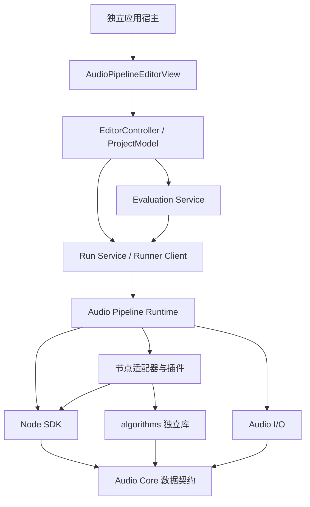

# 可扩展音频算法工作台架构与 Agent 实施指南

> **历史方案，已被替代。** 当前实施以 [JUCE 详细开发方案](plan_audio_pipeline_editor_juce.md)、[测试与验收准则](testing_audio_pipeline_editor.md)和 [Agent TDD 迭代规程](agent_loop_audio_pipeline_editor.md)为准。前端已确定为 JUCE，第一阶段即交付可操作的可视化闭环；本文的 ImGui 选型、CLI 先行阶段安排及 OLS 仓库背景不再作为本项目实施指令。本文保留用于追溯早期设计。

> 本文是独立项目的设计与实施输入，不代表已有实现或已完成验证。
> 文中项目名、目录名、接口名和命令是建议契约；Agent 落地时应实现并验证，不能当作当前存在的 API。
> 本文保存在 OLS 中作为设计交付物。依据 INDEX.md §5.1 的方案文档准入规则，当前不登记 OLS 正式知识库，不自动暂存或提交。

## 1. 项目目标与首要决策

构建一个可扩展的音频算法开发、调参、试听和验证工作台：

- 以 C++20 搭建应用、运行内核和公共接口。
- 前端是可由宿主承载的独立 `AudioPipelineEditorView`，首选 Dear ImGui。
- 底层有独立 `algorithms` 库，支持 C++ 算法、Python 算法和第三方 SDK 适配。
- 用户可以发现、添加、连接、替换算法节点，调整参数并比较结果。
- 首批覆盖 3A 相关处理、降噪、AEC 和波束形成；架构允许其他音频算法继续扩展。
- 无界面命令行与 GUI 使用同一项目格式、节点协议和执行内核。

**首要决策：先建立真实算法驱动的无界面闭环，再通过 View 展示同一套能力。**

首批接入建议选择 SpeexDSP 和 Pyroomacoustics，分别检验原生有状态算法及 Python/多通道/阵列扩展。WebRTC APM、RNNoise 是后续接入候选；如果近期业务优先级是完整 3A，可提前接入 WebRTC APM，但不能因此将其内部接口固化成通用框架。

第一轮验收以离线文件处理为主。实时试听属于下一阶段；低延迟设备处理是需要独立验证的能力，不得因为离线处理快于音频时长就宣称具备实时保证。

### 1.1 术语

| 名称 | 本文含义 |
|---|---|
| algorithms | 纯计算库与算法实例，不依赖 GUI 或 pipeline 图 |
| Node | 对算法、数据源、转换、分析或输出的适配单元 |
| Pipeline | 由有类型端口和连接组成的计算图 |
| View | 前端工作区；负责展示状态和发出编辑命令 |
| 算法基线 | 固定源码/模型/参数版本的参考实现 |
| 质量 benchmark | 固定数据、场景、评价方法和判定条件 |
| 性能 benchmark | 在已记录环境中测量初始化、处理耗时、内存和延迟等 |
| 实验 | 一次固定输入、图、参数、代码、初始状态和评测条件的运行 |

3A 通常涉及 AEC、噪声抑制和 AGC，具体库可能封装更多步骤。节点分类不决定处理顺序。

### 1.2 第一版范围

必须提供：

1. 音频文件输入输出、多通道选择、完整参数与数据版本记录。
2. 类型化多输入/多输出节点与 DAG 验证。
3. 有状态连续处理、重置、预热、尾部刷新。
4. C++ 节点和用户 Python 节点接入。
5. 降噪、AEC、波束形成三类代表性流程。
6. 项目保存/恢复、节点参数自动生成、撤销/重做。
7. 试听、波形、声谱图、A/B 对比和基础执行报告。
8. 无界面运行与回归验证。

后续阶段再实现：低延迟设备链、复杂反馈图、状态检查点、DLL 热卸载、完整代码 IDE、分布式执行、自动算法搜索。不能用这些扩展拖延首个可运行闭环。

## 2. 与 OIP AlgoEditor 的参考关系

OIP 是交互和架构参考，不是本项目的运行依赖。

| 参考位置 | 可借鉴的内容 | 本项目需要重新设计的内容 |
|---|---|---|
| `oip/view/AlgoEditor/AlgoEditor.cpp` | 节点库、画布、参数区、输入/输出/差分布局 | 独立 View，不依赖 OIP AppMachine、配置或文档事件 |
| `AlgoEditorPresenter.*` | 异步提交、请求去旧、结果回传 | 音频时间线、有状态实例、实验控制 |
| `AlgoEditorModel.*` | 图状态、输出缓存、展示缓存 | 与 wx 类型和 UI 节点分离的项目模型 |
| `oip/engine/core/GraphModel.*` | 拓扑与上下游遍历 | 命名端口、格式约束、多个输出、稳定实例 ID |
| `oip/engine/core/Parameter.*` | 参数描述生成 UI | 定义/取值分离、更新策略、结构化参数 |
| `oip/engine/nodes/python/PythonNode.*` | Python 调用与错误桥接 | 用户业务参数、持久实例、多个端口、真正的代码重载 |
| `AlgoEditorPreviewInput.*` | 输入快照和代次检查 | 完整通道与时间序列，保留预热历史 |

截至本文编写时，现有 `NodeContext` 有多个输入和单一 output；`AlgoEditorModel` 仍含 wx 类型；PythonNode 的主要参数是脚本路径、入口和重载开关。不可把这些接口直接宣称为通用音频 SDK。

不得引入 `SurfaceData`、`IntensityData`、VTK、光学单位、OIP 隐式后处理或单终端输出约束。若复制有价值的工具代码，应核查依赖和许可证，并补充针对本项目的契约测试。

## 3. 分层架构与依赖规则



图中的调用关系可以通过接口注入；具体插件由组合根注册，核心调度器不 include 具体 AEC、降噪或波束实现头文件。

| 模块 | 责任 | 禁止依赖 |
|---|---|---|
| `audio_core` | 音频/频谱/特征数据、时间、格式、几何 | GUI、图调度、具体算法 |
| `algorithms` | 无状态函数及有状态处理器、第三方库适配 | View、图模型、节点注册表 |
| `node_sdk` | 描述、端口、参数、处理生命周期、诊断 | ImGui、具体算法 |
| `nodes` | 算法与节点协议之间的薄适配 | GUI |
| `audio_io` | 文件、设备、格式转换边界 | GUI、业务图 |
| `audio_runtime` | 格式协商、执行计划、实例和缓冲管理 | GUI、具体算法分支 |
| `evaluation` | 数据集、指标、对比和报告 | GUI |
| `editor_application` | 项目、命令、历史、运行请求和展示状态 | ImGui 控件类型 |
| `editor_view` | 画布、参数、试听与分析面板 | 具体 algorithms 实现、Python 解释器 |
| `apps` | 生命周期、依赖组装、进程入口 | 不承载算法逻辑 |

架构验收：关闭 GUI 构建后，CLI、algorithms 和 runtime 的测试仍可构建运行；新增算法节点不修改 View 主体或调度器的算法判断分支。

## 4. 项目结构与构建交付

以下为独立源码仓库建议结构，`audio-workbench` 是工作名：

```text
audio-workbench/
├── CMakeLists.txt
├── cmake/
├── apps/
│   ├── editor/                  # 窗口、渲染、组合根
│   ├── cli/                     # 无界面执行与验证
│   └── runner/                  # 独立计算进程
├── libs/
│   ├── audio_core/
│   ├── algorithms/
│   │   ├── include/
│   │   ├── src/
│   │   └── adapters/            # SpeexDSP 等底层算法适配
│   ├── node_sdk/
│   ├── audio_io/
│   ├── audio_runtime/
│   ├── evaluation/
│   ├── editor_application/
│   └── editor_view/
├── plugins/
│   ├── builtin/
│   ├── speexdsp/
│   └── pyroomacoustics/
├── python/
│   ├── audio_node_sdk/
│   ├── audio_algorithms/
│   └── bindings/                # 项目自身 C++ algorithms 的 Python 绑定
├── examples/                    # 图、参数、用户插件示例
├── tests/                       # core、算法、适配、执行、项目、集成
├── benchmark/                   # 场景清单、数据获取说明、评价定义
├── dependencies/                # 版本、哈希、模型/数据来源与许可证记录
└── build/                       # 可丢弃构建与运行树
```

建议 CMake targets 与库目录一一对应。提供 `AUDIO_BUILD_EDITOR`、`AUDIO_ENABLE_PYTHON`、`AUDIO_BUILD_TESTS` 和可选算法插件开关。未启用的可选插件不要求安装其依赖。

开发顺序是 CLI/core 先可运行，再启用 GUI。第三方依赖锁定已验证的 tag/commit/哈希，禁止构建时无条件追踪 latest。Python 解释器、wheel 和原生依赖必须匹配；不得靠全局 `sys.path` 或机器 PATH 的偶然配置通过验收。

独立工程从自己的源码根构建，使用 `build/bin`、`build/etc`、`build/res`、`build/log`，不写源码资源目录。示例数据、模型和默认项目通过明确构建步骤暂存，用户音频通过明确导入/引用入口访问。

若后续选择在 OLS 仓库内落地而非创建独立仓库，必须从 OLS 根 CMake 接入并遵守其 build/、依赖根和运行目录约束；不能单独配置 `oip/` 或偷偷引入另一套运行目录。本次任务仅交付设计文档，不创建上述应用目录或更改 OLS 构建。

## 5. 首批算法选型与接入基线

| 候选 | 首次用途 | 注意边界 |
|---|---|---|
| SpeexDSP | 原生降噪/AGC、双输入 AEC、重采样 | 分清各处理器状态与耦合；参数映射以锁定版本 API 为准 |
| Pyroomacoustics | Python 波束形成、DOA、房间仿真 | 明确具体算法属于整段或流式；不假定整个包都可低延迟运行 |
| WebRTC APM | 后续完整 3A SDK 适配 | 首先作为复合节点，保留 reverse/capture 调用及线程约束 |
| RNNoise | 后续模型资源及有状态降噪适配 | 记录模型、帧长、采样率和幅值约定；不能凭猜测暴露参数 |

选型完成不等于接入完成。每个首批库先做独立直调示例，固定：源码版本、构建参数、运行环境、输入哈希、格式转换、模型、参数、初始状态、分帧和 flush 行为。

保存直调输出、诊断和耗时，之后用它检查 adapter/runtime 是否正确封装。直接调用和框架调用的比较要使用相同精度、相同状态序列及相同分帧；跨硬件或非确定性后端使用事先定义的容差。

底层 algorithms 可以使用类维护状态，但不得知道 node UUID、连线、ImGui 或项目 JSON。第三方库调用首先进入底层 adapter，再由薄 Node adapter 映射端口和参数。

## 6. 公共数据与时间契约

### 6.1 AudioBlock

内部首选规范化浮点音频、`float32`、平面布局 `[channel][sample]`。该约定不意味着每个插件原生接受此格式；转换必须由边界 adapter 或显式转换节点完成。

至少包含：

- `sample_rate_hz`、`channel_count`、`frame_count`、dtype、布局和 strides。
- `stream_id`、`clock_domain`、首样本序号与可换算的时间戳。
- 通道 ID/角色、可选阵列几何引用。
- `discontinuity`、有效样本数、流结束信息。
- 明确的 buffer 所有权和有效期。

整数时间戳应有明确 timebase；不同采样率间换算需保留精度。通道 ID 不等于数组下标；设备重排通道必须可追溯。

输入默认只读，节点不能修改上游共享数据。默认 Process 输入视图只保证当前调用内有效；若算法要留存历史，必须复制到自己的状态或显式持有有所有权的缓冲。输出在发布后不可变。跨 Python 边界先保证正确拥有与拷贝，再根据测量结果优化零拷贝。

### 6.2 其他基础类型

| 类型 | 必要元数据 |
|---|---|
| SpectrumBlock | 时间位置、采样率、FFT size、hop、window、归一化、复数布局 |
| FeatureBlock | 时间步长、维度、dtype、特征 schema |
| EventStream | 时间戳、事件 schema，例如 VAD/DOA |
| ArrayGeometry | 麦克风坐标、米制单位、坐标轴约定、通道 ID、校准版本 |
| Metrics | key、值、单位、统计区间、适用条件 |
| Artifact | 文件/模型引用、内容哈希、类型与版本 |

类型使用 namespaced ID 与 schema version，例如 `audio.pcm@1`；插件可注册扩展类型和可选查看器。未知类型默认显示元数据，不让主 View 依赖每种业务结构。

### 6.3 格式协商

节点描述允许表达支持采样率、固定/可变通道、端口间通道关系、帧长及 hop、必需/可选输入、输出格式和时间关系。

第一版执行前生成固定格式计划，不在 Process 中动态改变通道或采样率。不兼容连接给出具体诊断；自动插入的 resampler、reblocker、channel mapper 必须出现在执行计划与 UI 中，不得静默丢弃通道。

不能统一要求全部算法使用 10 ms。需要分帧适配时，用连续缓冲累计/拆分，保持样本顺序；最后不足一帧采用节点声明的补零/拒绝策略，记录有效区间和输出尾部策略。

## 7. 节点与插件协议

### 7.1 数据分离

| 对象 | 内容 |
|---|---|
| NodeDescriptor | 稳定 type ID、版本、端口、参数定义、能力、帮助 |
| NodeInstance | UUID、type/version、参数值、资源引用；不保存运行指针 |
| GraphDefinition | 实例、命名端口连接、所选输出 |
| PreparedGraph | 格式协商结果、调度顺序、缓冲和实例 |
| NodeRunRecord | 本次实际参数、状态、代码/模型版本、时间、诊断 |

边必须标识源节点/源端口和目标节点/目标端口；结果按 `(node_uuid, output_port_id)` 保存。不能按节点显示名绑定数据源，也不能用一个 output 指针承载所有输出。

### 7.2 状态与执行能力

按能力区分 `IBlockProcessor` 和 `IClipProcessor`：

- block：Prepare、Process、UpdateParameters、Reset、Flush、Release。
- clip：Prepare、ProcessClip、Reset、Release，输入是完整区间及其上下文。

上述是接口语义，不要求每个方法都是必须实现的虚函数。默认行为与不支持项必须明确，不能靠吞掉调用伪装支持。

批处理节点首版仅在离线运行中支持，作为流到片段的显式边界；其区间、预热、尾部策略进入计划。不得把整段 Python 算法塞进每帧 Process，或在实时试听图中不加提示地积累无限数据。

生命周期约束：

1. 一个运行图的每个有状态节点拥有独立实例；同类型两个节点不共享隐式全局状态。
2. 一个实例由其执行线程串行访问。UI 不直接修改正在执行的实例。
3. Prepare 完成模型加载及缓冲准备；Process 不重新创建算法实例。
4. Reset 区分新实验、seek、输入中断和配置重建。
5. Flush 在输入结束后排出有限尾部输出，再结束流；不得无限等待。
6. 所有成功、失败、取消路径都要释放资源。
7. 算法内部状态不属于项目保存内容，除非实现了显式版本化检查点能力。

### 7.3 参数协议

定义与值分开。基础类型包括 bool、int、float、enum、string、文件/模型引用、数组和结构；支持范围、默认值、单位、帮助、分组、visible/enabled 条件。条件使用受限声明式规则，不在 UI 中 eval 任意代码。

每个参数声明更新策略：

| 策略 | 行为 |
|---|---|
| BlockBoundary | 在确定的下一音频块边界更新 |
| Smoothed | 按已记录的平滑规则过渡 |
| ResetRequired | 重新建立状态并预热 |
| ReprepareRequired | 重建格式、缓冲或模型 |
| OfflineOnly | 只在下一次离线运行中应用 |

区分配置参数与只读运行统计；实际生效参数及生效位置进入报告。对于不支持动态更新的第三方 API，不能仅修改面板数值就宣称已生效。

### 7.4 manifest 示例

以下是项目自定义 Python Gain 节点的最小描述示例，不代表某个第三方库接口：

```json
{
  "schema_version": 1,
  "plugin_id": "example.basic_audio",
  "plugin_version": "0.1.0",
  "nodes": [{
    "type_id": "example.gain",
    "version": "1.0.0",
    "entrypoint": "gain_node:GainNode",
    "execution": {"kind": "block", "stateful": false, "realtime_verified": false},
    "inputs": [{"id": "audio", "type": "audio.pcm@1", "required": true}],
    "outputs": [{"id": "audio", "type": "audio.pcm@1"}],
    "parameters": [{
      "id": "gain_db", "type": "float", "default": 0.0,
      "minimum": -60.0, "maximum": 12.0,
      "unit": "dB", "update_policy": "BlockBoundary"
    }]
  }]
}
```

实现时补齐实际格式约束。SDK 工具可从装饰器生成 manifest，但 UI 扫描节点库时不导入全部用户代码；执行进程加载后校验描述与实现匹配。

### 7.5 Python 与原生插件

- Python 插件支持目录开发模式和锁定包模式；节点执行对象跨音频块存活。
- traceback 返回节点 UUID、文件和行号；stdout/stderr 有界收集，不阻塞处理。
- 原生绑定创建/销毁及 Python 对象释放要遵守 GIL 和解释器生命周期。
- 纯 Python 代码变化生成新 code hash、重建相关实例并使下游缓存失效；依赖模块或原生扩展变化优先重启 runner。
- `invalidate_caches()` 不能替代已导入模块的代码重载；同名文件不能只按 stem 作为全局模块身份。
- 原生首版采用编译期注册；后续 DLL 插件需要版本化 C ABI、宿主分配器/明确释放接口和异常边界。
- 不把 STL 容器或 C++ 类布局当成跨第三方编译器稳定 ABI；不把 DLL 热卸载列为首版承诺。
- 进程隔离解决故障恢复，不等于不可信代码的安全沙箱。

## 8. 图执行、状态缓存与实验控制

### 8.1 编译和执行

执行前必须检查：节点/插件可解析、端口存在、单输入连接规则、必需输入、类型和格式、参数、资源、DAG 无环、选定输出可达、运行模式支持、时间与通道约束。

验证通过后编译不可变 PreparedGraph，预分配可确定的缓冲。每个音频时间步按依赖顺序处理，同一实例不能并发处理不同时间块。

首版仅支持 DAG。AEC 的播放参考由独立输入流提供，不能用硬件回声关系创建同一时刻的零延迟计算环。反馈算法先封装在节点内部，未来再定义跨块 Delay 边。

节点结果显式区分：Produced、NeedMoreInput、EndOfStream、Failed、Cancelled。执行器不能将“本帧暂未输出”当成失败，也不能在失败后回退成上次成功输出。

禁用/Bypass 只有在节点声明有效输入到输出映射时才允许；多输入/多输出不能默认透传第一个输入。分支合并需要对齐时间和算法延迟，执行器只能缓冲或截取，不能消除物理/算法延迟。

### 8.2 增量与缓存

输出失效由输入内容、图连接、参数、实现/模型/环境版本与状态历史共同决定。移动节点和改变窗口布局不触发算法重跑。

有状态节点禁止仅用“当前音频块 + 当前参数”作为缓存键。第一版采用：

- 复用已完成、版本匹配的上游片段/文件产物。
- 从已知初始状态重放受影响的状态链，或者从声明支持且完全匹配的检查点恢复。
- 对依赖历史长度不确定的算法，从文件起点重放；固定预热时长只是实验协议，不能宣称与完整历史等价。
- 参数改变后，不复用未证明兼容的自适应状态。
- 布局、展示下采样和音频计算缓存分离；缓存有预算、淘汰及固定保留策略。

### 8.3 运行快照与取消

每次运行冻结项目、图、输入、参数、代码、模型、环境、随机种子和评测区间。结果至少携带 project ID、run ID、graph revision、input revision、parameter revision 和 code hash。

UI 只接受匹配当前请求的结果。参数拖动可先采用约 150～300 ms 防抖，耗时节点支持手动应用；数值应按真实测量调整。

普通取消在节点间/算法协作点检查。Python 死循环或原生阻塞通过终止 runner 恢复，不强杀单个线程。runner 重启后清除其所有内存缓存句柄；已保存文件产物可按完整版本重新验证。旧成功结果可供比较，但必须显示历史/过期状态。

## 9. 运行模式与进程边界

### 9.1 离线模式（第一版主线）

CLI 先以进程内 RunService 跑通；GUI 正式接入用户 Python 时使用同一 RunService 的独立 runner 部署。GUI 不能再实现一套计算流程。

runner 常驻，一个项目使用一个主要 Python 环境。整个执行计划在 runner 内完成，避免每个节点启动一次解释器或每条边跨进程拷贝。

命令和诊断通过带长度的本地消息传输；控制消息版本化，stdout 不混入协议。大数组使用共享内存或文件产物，首版正确复制也可接受，但必须记录传输成本。

大型载荷的描述包含格式、大小和所有权；运行结束、取消、崩溃后都能回收。先完成离线正确性，不为未经测量的零拷贝增加复杂度。

### 9.2 缓冲实时试听（后续阶段）

设备 callback 只进行有界的缓冲交接。Python/耗时处理在独立工作线程或进程执行，不进入设备回调；通过缓冲换取容错，并显示实际延迟。

队列容量、欠载/溢出和中断策略明确。不能无限积压；首版过载可停止并报错，不能无声丢弃多通道或 AEC 参考。

### 9.3 低延迟模式（独立验收）

只允许已验证节点。实时路径避免动态分配、阻塞锁、文件 I/O、解释器调用和同步 GUI 操作；缓冲/计划在控制线程准备，参数通过块边界命令应用。

记录设备缓冲、重分帧、lookahead、模型和队列延迟。RTF 小于 1 是吞吐指标，不是截止时间保证；还需测量尾延迟、超期次数、欠载与长时间稳定性。

## 10. 三类必须贯通的真实流程

### 10.1 降噪

```text
AudioFileSource → FormatAdapter → SpeexDenoise → FileSink
                                  └─────────→ Inspector / Metrics
```

验证幅值、格式、连续状态、参数生效、尾部和无噪声/含噪/静音输入。指标按数据是否有 clean reference 选择。

### 10.2 AEC

```text
CaptureFileSource ──→ Align/Format ──→ AEC.capture
RenderReference ────→ Align/Format ──→ AEC.render
                                       ↓
                                  FileSink / Metrics
```

固定 capture/render 时间关系、参考提取点、延迟、声学路径和初始状态。数据集至少区分远端单讲、近端单讲、双讲和路径变化；不能只用单讲结果证明所有场景有效。

实时接入时明确设备时钟域，异步设备可能需要漂移估计/补偿。补偿能力未实现时拒绝该配置或明确标记不可用，不能仅检查两个输入的标称采样率相同。

ERLE 等指标按适用区间计算，不能把双讲中的近端语音当成残余回声。完整 3A SDK 的 reverse/capture 调用顺序及互斥约束由 adapter 保证。

### 10.3 波束形成与 Python

```text
MultichannelFileSource + ArrayGeometry + TargetDirection
                         ↓
               Python Beamformer
                         ↓
              Audio / DOA / Diagnostics
```

首版选择 Pyroomacoustics 中一个明确的算法与调用方式，不承诺全库节点化。仿真数据用于确认几何和方向逻辑，随后必须加入真实同步阵列录音。

校验通道顺序、坐标轴、单位、标定、时间同步及目标方向。整段算法声明 clip 能力，不能伪装为流式。调整方向后可以通过相同数据进行 A/B，不硬编码波束形成与 AEC 的统一先后顺序。

## 11. Benchmark、数据与报告

### 11.1 三种验证分开

| 验证 | 比较对象 | 目的 |
|---|---|---|
| 接入正确性 | 原库直调 vs algorithms adapter vs Node/Runtime | 检查封装、状态、分帧和数据转换 |
| 算法质量 | 算法输出 vs clean reference/场景要求/听评 | 判断效果及退化 |
| 性能 | 处理耗时、内存、延迟、超期和吞吐 | 判断资源需求和运行模式 |

开源实现输出可以作为回归基线，但不是天然质量真值。不能生成当前输出后立即将其批准为正确 golden，也不能为通过测试放宽已确定的数值契约。

### 11.2 最小数据集

先使用规模可控的开发集：干净语音、稳定噪声、非平稳噪声、静音/脉冲/削波边界、AEC 成对输入、多通道仿真和真实录音。覆盖不同采样率、通道数以及不足整帧的文件。

样本记录来源、授权、哈希、采样率、通道布局、参考信号、期望有效区间。合成数据保存脚本版本、随机种子、SNR 定义和房间参数；不能在不同算法分支重新随机生成不同输入。

DNS Challenge 可作为后续数据与评价体系参考，不要求初期下载整个语料。开发集与最终验收集分开，仿真与真实数据结果分别报告。

### 11.3 指标与时序

- 有参考降噪可选择 SI-SDR、误差或可懂度指标；必须记录参考、对齐和尺度处理规则。
- 无参考评价、听评与有参考指标分别记录，单一分数不能证明所有音频质量。
- AEC 评估分单讲/双讲/路径变化；波束形成评估方向、干扰抑制与目标信号保真。
- 报告明确 onset/预热、尾部、有效样本、对齐偏移、处理延迟，不能自动移位或归一化后不说明。
- A/B 可提供响度匹配试听选项，但保留原始输出，数值评价不能被试听设置偷偷改变。

性能分为初始化、逐块稳态、整段和端到端。记录硬件、OS、编译类型、线程设置、采样率、通道、帧长、模型、预热和统计方法。逐块至少报告中位数、p95、p99、最大值和超期数。

`RTF = 算法处理耗时 / 输入音频时长`，同时说明是否含 I/O、初始化、传输与 flush。实时预算须结合块周期和其他处理成本。

有状态处理的重复测量要按实验定义重置，不得每帧 reset 以追求好看的耗时。Google Benchmark 仅用于适合的原生微基准，完整流处理仍由项目 runner 负责。

### 11.4 运行报告最低字段

实验 ID、项目/图版本、全部输入哈希、插件/算法/SDK/模型版本、Python 环境锁、配置参数、实际参数、生效位置、随机种子、初始状态策略、预热/评估区间、输出哈希、诊断、质量指标、性能统计、失败原因。

成功产物通过完成标记/清单发布；失败或取消产物不得成为成功缓存。批量输出应避免覆盖上一轮有效结果。

## 12. 前端 View 与交互契约

### 12.1 技术栈

首选 Dear ImGui docking + imgui-node-editor + ImPlot；窗口/渲染先选 GLFW + OpenGL。一旦决定 Windows 专用，也可选 Win32 + DirectX 11，但首版只维护一套已验证 backend。

锁定整个 UI 依赖组合并先做兼容性冒烟。声谱图采用分块/纹理与显示层下采样，不能每帧扫描整段长音频。中文字体、输入法、DPI、拖拽和快捷键需实测。

### 12.2 组合方式

```text
AudioPipelineEditorView
├── NodeLibraryView
├── NodeGraphView
├── ParameterInspector
├── TransportView
├── AudioInspectorView
├── ComparisonView
└── RuntimeMonitorView
```

宿主负责窗口、渲染、事件主循环和服务装配。`AudioPipelineEditorView::Draw()` 在宿主 UI 线程被调用；View 不创建自己的应用主循环、音频设备或 Python 解释器。

View 读取展示快照，通过 EditorController 提交命令。ProjectModel 是图和参数唯一权威，画布控件不能维护另一套不可追踪的算法图；控件坐标和选择状态可独立保存。

首版交互必须包括：

1. 搜索/拖入节点、按端口类型连线、查看具体无效原因。
2. 自动参数表单、单位/范围、默认值、预设、更新策略提示。
3. 多输出端口选择和独立观察，不要求唯一终点。
4. 运行到此处、运行所选输出、全量运行、取消。
5. 播放/暂停/循环、通道监听、评估区间与预热区间。
6. 输入/输出波形、频谱/声谱图、A/B 及基础指标。
7. 节点等待/处理/完成/阻断/失败/取消状态和 traceback。
8. 参数/拓扑撤销重做；撤销会创建新 revision，不能接受旧运行结果。

## 13. 项目持久化与可复现性

```text
example_project/
├── project.json        # 图、参数、资源、输出、schema version
├── ui.json             # 布局、坐标、观察端口
├── nodes/              # 项目自定义 Python 插件
├── environment.lock    # 解释器/包/原生依赖版本
├── inputs/             # 导入副本或资源清单
├── baselines/          # 已批准参考与评价协议
└── runs/               # 每次实验的清单、结果、报告
```

内部资源使用相对路径和内容哈希；外部引用要有显式类型，不静默遍历机器寻找同名文件。缺失资源时显示定位/重新导入操作。

保存使用临时文件加原子替换。未知插件保留节点原始描述、参数和连接并显示缺失，禁止删除或替换为默认算法。schema 与节点版本不兼容时给出迁移诊断，迁移前保留原件。

保存项目不等于锁定全部依赖；环境清单和模型必须可还原。首次只保证已验证平台的可复现范围，不声明跨硬件按位一致。

## 14. 分阶段实施与验收 Gate

每个阶段完成后报告交付物、命令、结果和限制。核心 Gate 不通过时先修复，不用 UI 演示替代运行正确性。

| 阶段 | 工作与交付 | 通过条件 |
|---|---|---|
| G0 工程与依赖 | 独立根 CMake、模块边界、依赖锁、测试入口；SpeexDSP/Python 环境冒烟 | 无 GUI 构建通过；确认实际库版本、许可证和 Windows 可用性 |
| G1 直调基线 | 原库直调、固定测试输入、输出、状态/分帧说明和报告 | 至少降噪、AEC、Python 波束示例可复现；失败明确诊断 |
| G2 核心与 CLI | Audio Core、Descriptor、图验证、生命周期、格式计划、文件 I/O | 多实例状态隔离；多输入/多输出、尾帧和 reset/flush 验证通过 |
| G3 插件与评测 | SpeexDSP Node、Python 插件、三类流程、评测报告 | 直调/adapter/runtime 一致；新增示例插件不改 View/调度器 |
| G4 最小 View | 独立 View、画布、自动参数、试听、波形/声谱、保存/恢复 | 相同快照与 CLI 输出一致；真实调参有效，撤销/恢复正确 |
| G5 runner 与实验 | 进程隔离、请求去旧、取消、代码重载、A/B、批量运行 | Python 出错/挂起可恢复；UI 保留图；旧结果不覆盖新实验 |
| G6 缓冲试听 | 设备适配、有界队列、时钟/通道检查、运行监控 | 过载可观察且按策略恢复；同步参考正确，长时间运行有记录 |
| G7 后续扩展 | 更多 3A/模型插件、参数扫描、检查点或低延迟能力 | 每项独立通过质量/性能/扩展性 Gate 后再声明支持 |

G1 允许先用直调脚本探索，G3 必须接入统一 runner。G4 可以开始界面实现，但最终依赖 G5 才能交付具备故障恢复的 Python 编辑器。能力开关和文档应反映实际完成阶段。

### 14.1 第一批 Agent 任务顺序

1. 检查目标源码根和适用的 AGENTS，输出当前环境、已有代码和实际依赖版本。
2. 建立 G0 最小构建，不复制 OIP GUI 或修改其业务代码。
3. 完成 SpeexDSP 原生示例、Python 波束示例和固定输入清单。
4. 依据真实接口收敛 AudioBlock、Descriptor、Processor 生命周期和错误契约。
5. 实现 CLI、单节点及双节点执行，再覆盖 AEC 双输入、分支和多输出。
6. 建立直接调用与框架调用的对比以及独立质量评价。
7. 通过新增用户 Gain/Python 算法插件检验扩展入口。
8. 将同一套 ProjectModel/RunService 连接到独立 View，再完善 runner、实验和实时能力。

### 14.2 建议命令契约

以下命令是待实现的目标接口，不是当前可执行命令。路径按最终项目实现调整，首版 CLI 至少应覆盖等价能力：

```text
audio_cli plugins list
audio_cli validate --project <project.json>
audio_cli run --project <project.json> --output-dir <run-directory>
audio_cli evaluate --run <run-manifest> --suite <suite.json>
```

validate 失败、执行失败、取消与评测不通过需要可区分的退出状态。GUI 和 CLI 共用 schema、格式协商、节点实现与报告构造逻辑。

## 15. 必须执行的验证与交付证据

| 验证类别 | 关键场景 |
|---|---|
| 算法适配 | 直调对比、幅值/通道/采样率、长短帧、尾部、状态 reset |
| 节点协议 | 缺失端口、可选输入、输出类型错误、参数越界、多输出 |
| 图执行 | 环、失效连接、分支、运行到此处、批处理/流式不兼容 |
| 有状态行为 | 两实例隔离、完整重放、seek/loop、参数变更后的状态策略 |
| Python | 新插件发现、语法/运行错误、代码变化、依赖缺失、挂起恢复 |
| 项目 | 保存/重开、schema/插件版本不匹配、未知节点无损保留 |
| 并发与恢复 | 旧请求返回、取消、View 关闭、runner 崩溃和缓存句柄失效 |
| 质量/性能 | 固定数据和有效区间、参考对齐、初始化/稳态/端到端分开 |
| GUI 集成 | 参数真实生效、正确端口预览、播放/A/B、状态及错误可见 |

优先测试以上行为和数值契约，不为可逆的样式微调编写镜像实现的测试。每个阶段保留可重新运行的命令和机器可读报告；没有真实数据或设备验证的能力应标注未验证，不能用 mock 结果宣称完成。

## 16. Agent 执行边界与完成定义

Agent 应遵守：

1. 先运行算法和评测闭环，再扩大 UI；不以“界面已出现”作为算法框架完成标准。
2. 插件必须通过协议扩展；禁止在画布、参数面板或调度器堆叠具体算法名称判断。
3. 不在 UI/音频回调中执行 Python、加载模型或等待计算结果。
4. 不强制统一帧长，不静默丢弃通道、重置自适应状态或改变算法处理顺序。
5. 不将整段算法伪装为低延迟节点，不把 RTF 当成完整实时证明。
6. 不伪造实测结果，不自动批准 golden，不自动提交 Git。
7. 按需查阅锁定版本的上游文档，记录与本文建议不同的实际约束。
8. 新增独立 algorithms 实现应有不依赖节点图的测试入口。

第一版完成需要同时满足：

- 独立应用及独立 View 可运行，CLI 可不依赖 GUI 执行相同 pipeline。
- algorithms 可脱离编辑器调用，C++/Python 节点使用同一描述与数据契约。
- 降噪、双输入 AEC、多通道 Python 波束形成有可复现实验。
- 用户新增节点不改 View/调度器，端口、参数和诊断自动接入。
- 项目可保存恢复，调参/A-B/试听/报告真实有效。
- 状态、预热、尾部、取消、失败和旧结果处理均通过验收。
- 实际支持的运行模式、平台和依赖版本有记录；后续功能保持为明确扩展项。

## 17. 上游资料与相关文档

外部资料核对日期：2026-10-16。上游 main/master 内容会变化，工程落地仍须锁定并验证实际版本。

- [SpeexDSP 官方镜像与开发入口](https://github.com/xiph/speexdsp)：原生 DSP 库与上游位置。
- [Speex 官方处理手册](https://www.speex.org/docs/manual/speex-manual/node7.html)：预处理、AEC、状态和参考信号时序；属于历史文档，具体能力以锁定源码为准。
- [WebRTC AudioProcessing 接口](https://webrtc.googlesource.com/src/+/refs/heads/main/api/audio/audio_processing.h)：帧、采集/反向流及线程约束。
- [RNNoise 官方镜像](https://github.com/xiph/rnnoise)、[公开接口](https://github.com/xiph/rnnoise/blob/main/include/rnnoise.h)：状态、帧长与模型生命周期。
- [Pyroomacoustics](https://github.com/LCAV/pyroomacoustics)：阵列仿真、波束、DOA、STFT 等参考实现。
- [PortAudio callback 规范](https://portaudio.com/docs/v19-doxydocs/writing_a_callback.html)：实时回调中的操作限制。
- [Python importlib](https://docs.python.org/3/library/importlib.html#importlib.reload)：重载与查找缓存的不同语义。
- [pybind11 嵌入文档](https://pybind11.readthedocs.io/en/stable/advanced/embedding.html)：解释器和 GIL 生命周期。
- [Dear ImGui](https://github.com/ocornut/imgui)、[Docking](https://github.com/ocornut/imgui/wiki/Docking)、[imgui-node-editor](https://github.com/thedmd/imgui-node-editor)、[ImPlot](https://github.com/epezent/implot)：前端组合与兼容性验证来源。
- [Microsoft DNS Challenge](https://github.com/microsoft/DNS-Challenge)：后续数据、场景和评价体系参考；各数据来源条款分别核查。
- [Google Benchmark](https://github.com/google/benchmark)：原生微基准工具。

OLS 历史参考（当前仓库不包含下列路径，只保留原出处，不构成独立项目依赖）：

- OLS 文档索引：`INDEX.md`
- OIP 算法引擎架构：`oip/README_AGENTS_Algorithm.md`
- OIP 算法引擎开发手册：`oip/README_DEV_Algorithm.md`
- AlgoEditor 主 View：`oip/view/AlgoEditor/AlgoEditor.cpp`
- AlgoEditor Presenter：`oip/view/AlgoEditor/AlgoEditorPresenter.cpp`
- NodeContext / AlgorithmNode：`oip/engine/core/AlgorithmNode.h`
- PythonNode：`oip/engine/nodes/python/PythonNode.cpp`
