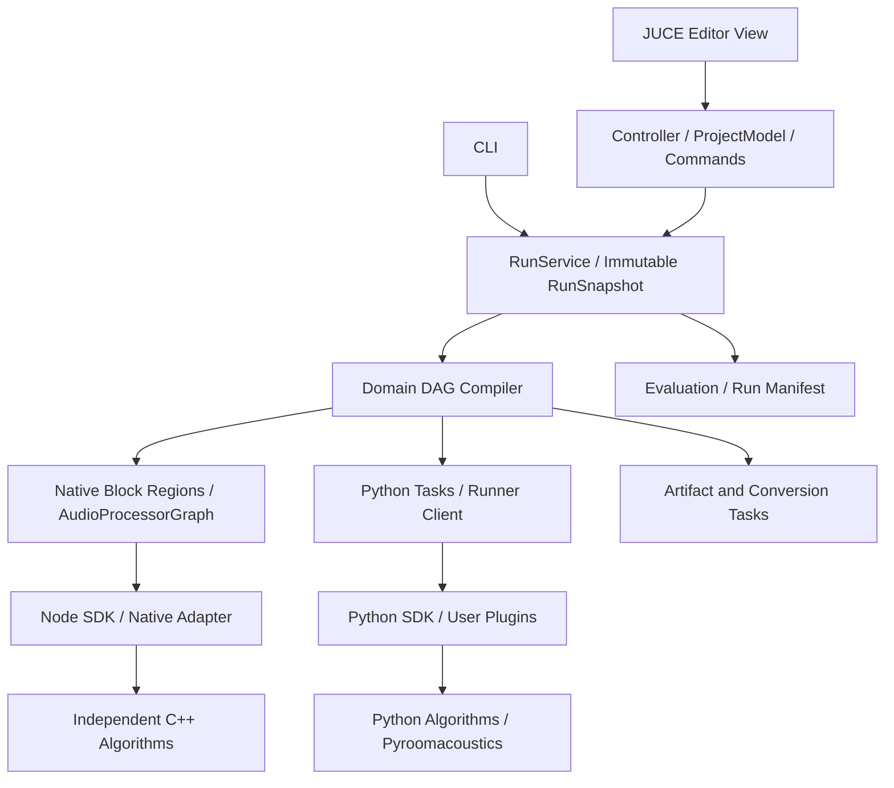

# JUCE 音频算法可视化平台详细开发方案

2026-10-22修订：当前执行按[交付收口补充约束](plan_delivery_convergence.md)，包括必要验证范围、M21后交付顺序及首版用户C++节点独立编译/加载。旧静态插件边界在本文§2.2、§6.2同步修订；原平台要求保留，文档更新不代表实现或验收通过。

## 1. 决策、适用范围与执行授权

采用 **JUCE + C++20 + 自定义 Node SDK + 统一 RunService + 独立 Python runner**。以 JUCE 官方 AudioPluginHost 的图编辑、处理器封装及交互代码作为起点，建立本项目的产品模型，保留有价值的上游实现及归属记录。无需把完整 VST 宿主功能搬入第一版。

目标是能够立即开始实现的桌面音频算法研发工作台：用户添加算法节点、连接命名端口、修改参数、运行、试听、查看波形/声谱及指标、保存工程，并继续接入自己的 C++ 和 Python 算法。

本文替代 [早期方案](plan_audio_pipeline_editor_agent_guide.md)中的技术选型和实施顺序；测试以 [测试与验收准则](testing_audio_pipeline_editor.md)为准；开发方法以 [Agent 迭代规程](agent_loop_audio_pipeline_editor.md)为准。若三者发生实际冲突，先按用户最新指令处理，否则在 `doc/decisions/` 记录最小一致修订，不留下两套相反的有效规则。

2026-10-17 增量：当前文字叠字、节点库拖放和连线插入修复，按[节点交互专项方案](plan_editor_node_interaction.md)、[专项验收](testing_editor_node_interaction.md)及[专项迭代规程](agent_loop_editor_node_interaction.md)实施。专项优先修复已暴露的图编辑阻断，仍保留原 G0/G1 未完成验收，不代表平台 Gate 已通过。

2026-10-18 增量：当前算法库与编辑器隔离按[详细重构方案](plan_architecture_refactor.md)、[重构测试准则](testing_architecture_refactor.md)、[重构 Agent 规程](agent_loop_architecture_refactor.md)的R0～R6直接实施。该顺序用于当前重构，替代此前“先完成NI专项再做独立工作”的排程；原G0～G6与NED全部必需验收仍有效。保持现有Gain可运行，先以AR-03.a结果身份行为为Red，再完成算法单一实现和通用适配；常规过程无需确认，计划接口须先检查实际存在。

2026-10-16 编写本文时，当前工作区仅包含方案文档，没有应用代码和已经验证的构建。下列目录、类名、命令和测试 ID 是待实现契约，不代表已经存在。后续 Agent 从当前仓库根开发，不创建另一个源码根，不引入 OLS/OIP 运行依赖。

用户已授权按方案直接开发并进行自验证、自迭代，常规过程无需确认。允许创建源文件、测试、演示数据、构建配置、局部重构与修复；遵守工具权限。不得自动购买、发布、推送、提交 Git 或改动无关文件。许可不明时先完成本地开发及许可证记录，不自行作出商业分发承诺。

## 2. 首版产品边界

### 2.1 必须交付

| 领域 | 首版能力 |
|---|---|
| 可视化图 | 节点搜索/添加/移动/删除，命名端口连线/断线，DAG 检查，节点状态和具体错误 |
| 参数 | 描述驱动的 bool/int/float/enum/string/path 表单；范围、默认值、单位、预设；必要的数组/结构编辑器 |
| 音频 | WAV PCM16/float32 导入导出；内部 float32 planar；16/48 kHz；单/双通道与四通道阵列验收 |
| 算法 | C++ Gain、Speex 降噪、双输入 Speex AEC；Python Gain/有状态示例、Pyroomacoustics 波束形成 |
| 编辑 | 参数/拓扑撤销重做，图布局与工程保存恢复，未知插件无损保留 |
| 运行 | GUI/CLI 共用计划与执行服务，原生块处理与 Python 离线任务混合，取消/失败恢复 |
| 分析 | 波形、声谱图、通道选择、已渲染音频播放、A/B、峰值/RMS/裁剪计数和场景指标 |
| 可复现 | 输入/脚本/模型/依赖版本、参数、有效区间、输出、运行报告和成功标记 |
| 扩展 | 内置C++节点可静态注册；用户C++节点仅用发布SDK独立编译DLL，部署后启动现有宿主加载；Python插件加入目录后可被发现并执行 |

首版的“试听”指播放已经完成渲染的输入/输出，允许循环和通道监听。设备打开失败时仍可离线处理，界面显示真实诊断。新增算法本身用 C++/Python 编写；画布编辑的是算法流程。组合子图、图形化编写算法内部代码属于后续范围。

### 2.2 推迟的能力

低延迟设备算法链、Python 实时保证、任意采样率/通道组合、反馈环、自动插入任意转换、运行中的DLL热替换/热卸载、状态检查点、完整代码 IDE、分布式执行、通用 VST 扫描/隔离宿主、子图封装和自动算法搜索。用户自定义C++节点独立编译DLL并在启动时加载已于2026-10-22转为首版必需，具体见§6.2；不要把热卸载后置解释为整个插件加载后置。未实现能力不得显示为已支持。

## 3. 架构与模块边界



| 模块 / CMake target | 职责 | 依赖约束 |
|---|---|---|
| `audio_core` | 格式、时间、通道、几何、诊断、产物引用 | C++ 标准库及小型公共基础依赖；无 JUCE GUI/Python/图模型 |
| `audio_algorithms` | 原生 Gain、有状态处理器及 Speex 底层封装 | 依赖 core 和算法依赖；不含节点 UUID、JSON 项目或 JUCE AudioProcessor |
| `audio_node_sdk` | 描述、参数、端口、工厂和生命周期契约 | 依赖 core；不依赖具体算法和 GUI |
| `audio_project` | 领域图、序列化、资源、版本、命令历史 | 依赖 SDK；不存 JUCE 对象指针 |
| `audio_io` | 文件读写、显式转换、音频产物 | JUCE 非 GUI 模块可用于 I/O；核心类型不泄漏 JUCE buffer |
| `audio_juce_backend` | 原生 block 适配、图编译、通道映射、渲染 | JUCE 音频模块；不依赖 View |
| `audio_runner_client` | 进程、消息、取消、重启和载荷生命周期 | 不包含 Python 解释器；支持禁用 Python 构建 |
| `audio_runtime` | 任务 DAG、原生区域/Python 任务调度、快照和运行产物 | 不依赖 GUI，禁止按具体算法名字分支 |
| `audio_evaluation` | 独立指标、对齐规则、质量/性能报告 | 不依赖 View |
| `audio_editor_application` | 编辑控制、展示快照、异步请求 | 不依赖 JUCE 控件类型；与 CLI 共用 RunService |
| `audio_editor_view` | JUCE Components、画布、参数和音频检查面板 | 不直接执行算法或启动解释器 |
| `nodes_*` | 描述和薄适配 | 由组合根注册；不得反向引入 View |

`AudioPipelineEditorView` 是可嵌入的 JUCE `Component`，宿主负责窗口和事件循环；服务通过构造注入。它不创建自己的应用主循环。可提供独立 editor 应用，也可嵌入后续 JUCE 宿主。

### 3.1 项目模型与 JUCE 图的关系

`ProjectModel` 是唯一权威：领域节点、命名端口、参数、资源、选定输出和 revision 均在此维护。JUCE `AudioProcessorGraph` 是某个不可变运行快照中一个原生音频区域的执行投影，可丢弃并重新构造，不单独保存为项目真相。

端口可为 `audio.pcm@1`、`array.geometry@1`、`event.doa@1`、`metrics@1`、`artifact@1` 等。只有符合固定采样率、块处理、同步音频约束的区域进入 JUCE 音频图；几何、指标、整段 Python 不伪装成音频通道或 MIDI。

命名音频总线在编译时映射到 JUCE bus/channel，保存可逆映射及诊断。AEC 的 `capture` 与 `render` 必须保持独立角色；UI 连线显示总线端口和通道摘要，无需让用户操作内部扁平索引。

### 3.2 执行计划

统一编译器把领域 DAG 转为任务 DAG，首版串行调度 ready task：

1. 校验描述、参数、资源、端口、类型、环、模式及格式约束。
2. 将兼容的原生 block 节点合并为一个或多个 JUCE 区域。
3. Source、Sink、离线重采样、Python block/clip、评测等作为明确任务或边界。
4. 区域之间首先通过有清单的 float 音频产物传递；不要求共享内存。
5. 执行后仅发布完整成功产物；取消/失败保留诊断，不发布成功缓存。

Python block 节点也在独立 Python 任务内分块执行，实例跨块存活；其输入输出在原生区域边界物化。Python clip 一次接收完整区间。这样 GUI 和 CLI 使用同一套编译/执行逻辑，且不在 C++ 音频回调跨进程等待。

一项运行默认每个项目串行；有上限的请求排队/替换，参数更新可取消旧运行并启动新快照。v1 不做并发多实验共享 Python 进程，也不实现通用的多速率在线调度器。

## 4. 工程、构建与交付目录

```text
audioalgo/
  AGENTS.md
  CMakeLists.txt
  CMakePresets.json
  cmake/
  apps/editor/                 # AudioAlgoEditor
  apps/cli/                    # audio_cli
  libs/                       # 与上述 targets 对应
  plugins/builtin/
  plugins/speexdsp/
  python/audio_node_sdk/
  python/audio_algorithms/
  python/runner/
  examples/projects/
  examples/plugins/
  tests/unit/
  tests/integration/
  tests/gui/
  tests/fixtures/
  benchmark/suites/
  dependencies/               # 锁定信息与许可证记录
  scripts/                   # 构建、测试、产物验证
  doc/decisions/
  doc/development_status.md
  build/                     # 可丢弃构建、运行和证据
```

基线平台 Windows x64；C++20、MSVC、CMake、Python 3 的实际版本在 G0 实测后锁定。先检测工具链，不能直接使用机器默认 `python`；编写本文时 PATH 中的默认 Python 指向旧版 Python 2.7，应显式定位 Python 3。不得把这个历史观察当作后续机器的固定事实。

优先使用已存在的依赖缓存；否则获取上游已发布稳定版本，记录 tag 与完整 commit/hash。JUCE 与 Speex 在 CMake 中使用锁定源码；Python 使用独立 `.venv` 和依赖锁，记录解释器绝对路径、版本与包版本。禁止构建时追踪 main/master/latest，禁止依赖未经声明的全局 PATH/sys.path。

首选 Catch2 + CTest，Python 使用 pytest。GUI 的组件/命令测试可在初始化 JUCE 消息环境后使用 Catch2，必要时使用 JUCE UnitTestRunner；所有失败必须汇总到非零进程退出码。不可把 GUI 组件测试冒充无显示环境可运行的 pure-core 测试。

提供选项 `AUDIO_BUILD_EDITOR`、`AUDIO_ENABLE_PYTHON`、`AUDIO_ENABLE_SPEEXDSP`、`AUDIO_BUILD_TESTS`。关闭 editor 后 CLI、纯算法和运行测试仍能构建，不创建可见应用窗口、不打开音频设备；JUCE backend 允许依赖锁定版本所需的非 View 模块，不能声称完全不依赖 JUCE。若 AudioProcessorGraph 的构建/重建需要消息线程，应在 CLI 内显式初始化并驱动 JUCE 消息环境，不依赖 View 或桌面交互；纯 core/algorithm 测试不初始化该环境。

构建 presets 至少为 `windows-debug`、`windows-release`、`windows-headless`；产物统一到 `build/<preset>/bin`。运行输出、报告、截图统一在 `build/runs/`、`build/reports/`，示例资源由显式构建/安装步骤暂存。新增源码不写入其他仓库或工具安装目录。

## 5. 数据、时间和分帧契约

### 5.1 音频与产物

内部计算为 float32 planar，标称满幅为 ±1，允许中间浮点超幅但必须报告；写 PCM16 时显式饱和量化并记录裁剪数量。输入默认只读，输出发布后不可变；借用的 buffer view 仅当前调用有效。Python 首版采用拥有内存的拷贝。

AudioFormat 描述采样率、通道及通道角色；AudioSpan 描述流 ID、clock domain、首样本整数序号、帧数、有效区间及中断。ArrayGeometry 采用米和明确坐标系，按稳定通道 ID 映射。时间换算使用有理比例或整数累计，禁止逐块浮点累加造成漂移。

ArtifactRef 描述内容哈希、相对路径、格式、逻辑起点/有效区间、实际帧数、引入延迟、所有权与 schema。任务边界最初可用 float WAV + JSON sidecar；由 run manifest 管理有效性。只计算有效区间，不能把补零或预热当成真实信号。

v1 格式转换使用显式 `Resample`、`ChannelMap`、`Reblock` 能力。重采样位于离线任务边界，JUCE 原生区域内部保持同采样率；通道映射不静默丢弃。自动插入不作为首版验收要求。

### 5.2 原生固定帧算法与 JUCE 回调

领域 block API 至少返回每个端口的 consumed/produced 数量、状态和诊断；`NeedMoreInput` 不意味着未消费，具体数量必须显式。禁止一次调用后无条件丢弃输入。不同输出单独描述有效区间与 EOS。

进入 JUCE 区域的 wrapper 必须遵守一次回调 N 入/N 出的音频时间推进，底层固定 F 帧算法使用持久 FIFO 累计/拆分；不得把 `NeedMoreInput` 直接传给 JUCE 图当作本次没有输出。

wrapper 在 Prepare 阶段确定有界的适配延迟 L、底层算法延迟和队列容量；启动填充、暂未有效的输出区间明确标记。使用 `setLatencySamples` 声明已知固定延迟，并验证锁定 JUCE 版本的分支延迟补偿行为。未知或不可界定延迟的处理器作为离线任务，不进入该区域。

原生区域的 sink/tap 必须是计划中实际被驱动的输出；“运行到此处”通过所选端口反向裁剪领域图后重新编译。观察端口不能额外调用有状态算法；通过真实路由或只读采集获取结果。

测试覆盖 F=480 与 F=512 串联，以及宿主块长 1/127/256/480/512/1024 和不整帧尾部；验证消费/输出计数、连续性和声明延迟，不只验证无崩溃。

### 5.3 延迟、尾部与对齐

区分信号逻辑时间、算法 lookahead、缓冲延迟和设备播放延迟。原生区域补偿后的区域延迟只在边界统一处理一次，禁止同时在 wrapper 和 Sink 再裁剪。

保存原始输出区间及延迟元数据，并生成明确标注的逻辑对齐音频产物供默认 A/B；对齐只应用已声明的确定延迟。保留原始输出，评测不得偷偷互相关寻优、归一化或裁剪不同区间。

尾部流程为标记输入 EOS → 根据节点声明补齐末帧 → 有界 drain → 完成。每种节点声明尾部是否保留、原始/有效长度和最大 drain 预算；Speex 等没有公共 flush API 的算法不能伪造 flush，adapter 需说明补帧与有效输出策略。循环/seek 重建状态或从起点重放，首版不复用不兼容的自适应状态。

AEC 首版输入为同采样率、同步时钟域、明确起始偏移的成对文件；对齐后处理有效交集，剩余区间单独记录；无法确定关系时报错。可选显式 offset 不等于自动估计。异步设备漂移补偿留到后续。

## 6. Node SDK、参数与扩展入口

### 6.1 描述与实例

| 对象 | 内容 |
|---|---|
| NodeDescriptor | namespaced type ID、版本、端口/格式、参数、执行能力、帮助 |
| NodeInstance | UUID、type/version、参数值、资源引用；无运行指针 |
| GraphDefinition | 节点、命名端口连接、选定输出、schema |
| PreparedPlan | 不可变任务 DAG、JUCE 区域映射、资源预算、延迟/尾部策略 |
| RunSnapshot | 图/参数/输入/代码/环境固定副本、唯一 run ID 和 revision |
| RunRecord | 实际参数、时序、输出、诊断、性能与质量结果 |

端口基数显式声明；必需输入最多一条边，求和通过 Mixer 节点表达。参数与只读统计分离。首版默认参数 `OfflineOnly`，编辑后用于下一次完整渲染；可提供防抖或手动 Apply。实时 BlockBoundary/Smoothed 能力只有实现并验证后才显示可用。

基础参数支持 bool/int/float/enum/string/path；几何等结构采用描述驱动的表格/数组编辑器和 JSON 导入。未知结构可只读显示并解释暂不能编辑，不伪装为完整支持。visible/enabled 条件采用受限声明式表达，不 eval 任意代码。

### 6.2 C++ 扩展

算法核心提供 Prepare/Process/Reset/有限尾部处理等实际能力，不知道 JUCE、节点或 UI。Node adapter 映射端口/参数和错误，JUCE wrapper 只处理音频 backend 约束。内置节点保留静态工厂注册；用户节点必须可在仓库外仅使用发布Node SDK独立构建DLL，经配置的插件目录在启动时发现和装配，不重新编译或链接宿主。修改节点只重建插件并重启应用。

既有`example.cpp_channel_swap`继续验收静态扩展性；另用全新外部插件验证独立SDK构建、动态发现、自动表单与实际算法输出，宿主EXE及通用View/编译器/调度器保持不变。DLL边界使用版本化C ABI、opaque句柄及明确的内存/生命周期责任；不承诺任意编译器C++ ABI互通、运行中热卸载或原生崩溃隔离。用户流程、最小接口与新增必需UPN-01～06见[补充约束第5节](plan_delivery_convergence.md#5-c用户节点独立编译与加载新增必需范围)，当前均为待实现。

### 6.3 Python 扩展

目录插件包含 `manifest.json` 和模块文件；GUI 扫描描述，不导入用户模块。下面是待实现的本项目协议示例，非 JUCE/第三方现成 API：

```json
{
  "schema_version": 1,
  "plugin_id": "example.basic_audio",
  "plugin_version": "0.1.0",
  "nodes": [{
    "type_id": "example.python_gain",
    "version": "1.0.0",
    "entrypoint": "gain_node:GainNode",
    "execution": {"kind": "block", "stateful": false, "realtime_verified": false},
    "inputs": [{"id": "audio", "type": "audio.pcm@1", "required": true}],
    "outputs": [{"id": "audio", "type": "audio.pcm@1"}],
    "format": {"sample_rates_hz": [16000, 48000], "channels": [1, 2, 4]},
    "parameters": [{"id": "gain_db", "type": "float", "default": 0.0,
      "minimum": -60.0, "maximum": 12.0, "unit": "dB", "update_policy": "OfflineOnly"}]
  }]
}
```

Python SDK 约定 `prepare(context)`、`process(inputs, context)`、`reset(reason)` 及必要的 `flush`；clip 对应 `process_clip`。实现时给出完整类型标注、输入输出所有权、状态及错误规范。NumPy 数组为 `[channels, samples]`、float32；加载后校验描述与真实行为。

每个节点一个对象，跨块保持；同类两个节点不共享隐式状态。以有状态计数/滤波示例证明未逐块重新构造。模块身份包含插件 ID 和 code hash，不只用文件 stem。

runner 采用显式 Python 3 可执行文件启动 `python -m ...`；C++ GUI 不嵌入 CPython。后续确需共享 C++ 算法时提供 pybind11 扩展模块，不要求第一版先完成嵌入式解释器。

## 7. 进程、快照与故障恢复

首选本地 loopback TCP 控制通道，4 字节大端长度 + UTF-8 JSON，控制消息上限 1 MiB；只接受宿主创建的连接，使用每次进程启动的随机 token 进行握手，token 不进入日志。此机制用于协议隔离，不宣称是用户代码安全沙箱。

协议至少包含 version、request_id、run_id、revision、message_type；支持 hello、execute、progress、diagnostic、result、cancel、shutdown。stdout/stderr 通过独立管道有界收集，不能混入控制协议。未知消息类型、过大长度、断连和错误版本应可诊断退出。

大数组首先通过 run 目录中的音频/数组文件和 sidecar 引用。输出写临时文件，完成校验后原子发布清单；取消与崩溃删除/隔离不完整输出。路径限定在明确的运行/插件/资源根；执行前校验实际大小、dtype、形状及内容哈希。

每个项目一个主要 Python 环境，一个 runner 同时执行一个任务。代码修改先物化脚本及本地模块快照、计算 hash，再启动/重启 runner；原生扩展或环境改变同样重启。不把 `invalidate_caches` 或 `reload` 当作完整重载实现。

Python 取消采用协作请求，默认等待 2 秒；仍未退出则终止整个 runner，从用户取消开始总计默认 5 秒内完成回收与状态更新。Windows 使用可回收进程树的机制，如 Job Object；不得强杀单个线程。超时仅是测试场景的恢复预算，可配置且记录。

首版原生区域在受控后台线程执行，在块/任务边界协作取消，捕获可恢复的 C++ 异常。进程内原生访问冲突或无响应的第三方调用无法依靠线程取消安全恢复；完整原生进程隔离作为后续扩展，不把 Python runner 的恢复保证泛化到全部原生故障。

runner 重启导致该进程全部内存句柄失效。GUI 保留工程和可查看的历史成功结果；旧结果必须标明历史，不能覆盖当前 revision。当前请求失败也不能自动伪装成上次成功结果。

## 8. 可视化界面与交互

```text
┌────────────────── 工程 / 导入 / 保存 / 运行 / 取消 ──────────────────┐
│ 节点库       │                  图画布                   │ 参数面板 │
│ 搜索/分类    │   命名端口、连线、状态、错误、运行到此处   │ 自动表单 │
├─────────────┴──────────────────────────────────────────┴─────────┤
│ 播放 / 暂停 / 循环 / 通道 / 原始-A / 处理-B / 有效与预热区间       │
│ 波形 / 声谱图 / 指标 / 日志 / Python traceback / 历史运行           │
└──────────────────────────────────────────────────────────────────┘
```

图交互借鉴并适配 AudioPluginHost 的 GraphEditorPanel；外观可调整，但图编辑必须通过 Controller 命令修改模型。节点坐标、缩放、选中项和面板布局独立保存；拖动节点不改变计算 revision、不重跑算法。

默认首开提供可运行的 File → Gain → Output 示例和生成的演示音频。首个可视化 Gate 通过添加/连线/调参/运行/观察/播放暂停/保存形成真实闭环，不能使用预先计算的假结果替代。

参数表单根据 Descriptor 生成；按输入格式诊断连线无效原因。多输出以 `(node_uuid, port_id)` 观察；所有输出都可独立选择，不要求唯一终点。撤销/重做创建新 revision，不复用旧 revision 接收权限。

GUI 执行异步，消息线程只处理交互与展示。波形/声谱离线分块生成、有预算的多分辨率缓存；绘制复杂度随可视范围/像素变化，不在 paint 扫描整段录音。STFT 记录窗口、FFT、hop 和归一化；浮点图像缓存与计算产物分离。

播放已渲染产物时仅在设备 callback 做有界缓冲读取；解码、磁盘 I/O、Python 和图重建不得进入回调。A/B 切换采用相同逻辑位置、淡变避免切换爆音；可选响度匹配只用于播放，不改存储结果和指标。

中文路径/字体、DPI 100/150/200%、快捷键、拖动和设备不可用场景均需验证。首版不强制内置代码编辑器，可显示脚本定位和重载入口。

## 9. 持久化与可复现实验

项目目录包含 `project.json`、`ui.json`、`nodes/`、`environment.lock`、资源清单及 `runs/`。内部相对路径 + 内容哈希；外部引用显式标记，不能扫描整机寻找同名文件。保存使用临时文件与同文件系统原子替换；迁移先保留原件。

未知节点保留完整原始描述、参数和连接，并显示缺失；不能悄悄删除或替换。已知节点的预设/配置保存与自适应内部状态区分，首版不持久化内部状态。

运行至少记录：run/project ID、图/输入/参数 revision、全部输入 hash、实际生效参数、代码副本/hash、SDK/算法/依赖/模型版本、Python 环境、随机种子、初始状态、预热/有效区间、延迟/尾部、输出 hash、诊断、质量及性能数据。成功使用 `complete.json` 最后发布；失败/取消不写成功标记。

v1 仅复用完整、版本匹配的文件/运行产物；不缓存自适应内部状态，不按“当前块 + 参数”判断有状态缓存。显示历史结果允许，必须明确过期状态。

## 10. 真实算法流程与验收数据

| 流程 | 节点与输入 | 必须验证 |
|---|---|---|
| 基础原生 | File → Gain → Output；分支到分析 | 独立数学 oracle、多通道、参数真实生效、尾帧 |
| 降噪 | File → SpeexDenoise → Output | int16/float 幅值转换、持久状态、静音与含噪语音、直调一致 |
| AEC | Capture + Render → Align → SpeexAEC → Output | 角色/时序、延迟、单讲/双讲、状态与剩余区间 |
| Python block | File → PythonGain/Stateful → Output | 实例跨块存活、异常定位、与 C++ 语义一致 |
| 波束 | 四通道文件 + Geometry + Direction → Python DAS → Audio/Diagnostics | 米制坐标/通道映射、目标方向、整段边界、真实数据 |

每个第三方先做原库直调，后测 algorithms adapter、Node/runtime 和 GUI/CLI 一致性。Pyroomacoustics 首选明确的 delay-and-sum 接口/调用方式，不承诺全库低延迟；不把“仿真波束方向看起来正确”当作真实阵列录音验收。

数据首先使用自生成、固定 seed 的正弦/脉冲/噪声/延迟回声/远场平面波，保留独立解析 oracle；质量评价再加入授权清晰的语音与真实同步阵列数据。任何外部数据缺失时标注对应质量 Gate 未通过，不能使用同一算法生成的输出作为天然真值。

数值阈值、数据选择和通过条件统一见 [测试文档](testing_audio_pipeline_editor.md)，不在代码中另建宽松标准。性能不以 RTF<1 宣称实时；首版实时能力状态保持未验证。

## 11. 阶段任务、TDD 切片与通过条件

阶段按 G0→G6 推进。每阶段做纵向切片，编译、测试、UI/CLI 演示同步演进；不得先搭完所有框架再补功能。所有测试 ID 均在测试文档定义。

| Gate | 交付与首条 Red 行为 | 必须通过 |
|---|---|---|
| G0 工程与证据入口 | 根 CMake/presets、依赖锁、Catch2/pytest、报告脚本、状态文档；先证明故意失败用例使验证退出非零，再移除探针 | BLD-01～04、LOOP-01；GUI 基础窗口能启动，headless 不创建可见应用窗口 |
| G1 可视化 Gain 闭环 | 项目最小模型、Source/Gain/Sink、JUCE 图、画布/参数/运行/波形/播放暂停、CLI、保存；首条 Red 为 Gain 对已知信号输出错误被断言捕获 | CORE-01、DSP-01、GRAPH-01～03、IO-01、PRJ-01、UI-01、UI-02、E2E-01；真实图交互证据 |
| G2 图与状态正确性 | 命名多端口、分支、固定帧 FIFO、延迟/尾部、参数描述、撤销；首条 Red 为不整帧串联丢样或分支错位 | CORE-02、GRAPH-04～07、DSP-02、UI-03、PRJ-02～04、E2E-02 |
| G3 Python 与混合执行 | 独立 runner、SDK、Gain/Stateful、代码快照、任务边界、取消/恢复；首条 Red 为跨块实例被重建 | PY-01～08、RUN-01～05、E2E-03；故障不能导致 UI 丢工程 |
| G4 真实算法 | SpeexDenoise/AEC、Python DAS、直调及固定数据；首条 Red 为直调/封装幅值或状态差异 | ALG-01～04、QUAL-01～03、E2E-04；数据不足则 Gate 保持未完成 |
| G5 完整工作台体验 | 播放、通道/A-B、声谱、区间、错误/历史、多输出观察、长文件缓存；首条 Red 为过期结果覆盖或 A/B 位置不一致 | UI-04～07、RUN-06、PERF-01～03、E2E-05；真实设备试听单独记录 |
| G6 可交付与扩展验证 | 新 C++/Python 插件示例、打包、隔离环境安装、使用文档、完整回归 | EXT-01～02、PKG-01、LOOP-02，以及全部累计必需测试；无已知阻断缺陷 |

G1 只需把必要的简单模型与原生图跑通；不要求先完成 G2/G3 的通用协议。G2 对测试用固定帧处理器完成适配，G4 再接真实 Speex。G1 简单波形可直接由已有音频生成，G5 再做长文件显示缓存，禁止过早建设复杂框架。

阶段顺序表达实现依赖，不要求因某个外部验收条件停掉所有开发。例如缺少真实阵列录音时，G4 保留未完成，可继续不依赖该录音的 G5/G6 功能；最终累计 Gate 仍不得跳过该条件。

每次 Gate 记录输入、平台、依赖、命令、exit code、通过/失败/跳过数、报告位置与限制。必须从已注册测试清单检查测试非零且完整，不能只根据 CTest 输出“100%”判定。故障注入仅使用项目受控 fixture/测试插件，不修改用户代码。

## 12. 待实现的运行与验证命令

以下为目标命令，Agent 必须在代码中实现、实际运行并记录解析后的路径；未实现前不得声称运行成功。测试使用精确注册名映射测试 ID，并让所有脚本失败时返回非零。

```powershell
cmake --preset windows-debug
cmake --build --preset windows-debug
ctest --preset windows-debug --output-on-failure --no-tests=error
cmake --preset windows-headless
cmake --build --preset windows-headless
ctest --preset windows-headless --output-on-failure --no-tests=error
& .\.venv\Scripts\python.exe -m pytest tests\integration\python --junitxml=build\reports\pytest.xml
& .\.venv\Scripts\python.exe scripts\verify_gate.py --gate G1 --config windows-debug
& .\.venv\Scripts\python.exe scripts\verify_gate.py --gate G6 --config windows-release
```

`verify_gate.py` 在 G0 建立最小骨架，后续增量实现：执行所需检查、比对预期 ID、收集报告，必需用例失败/缺失/跳过/超时均非零；GUI/设备证据缺失输出 `not_verified` 并阻止相应 Gate 通过。它不是读取一份自填 pass JSON 就返回成功。

CLI 建议契约：

```text
audio_cli plugins list
audio_cli validate --project <project.json>
audio_cli run --project <project.json> --output-dir <new-run-dir>
audio_cli evaluate --run <run-manifest.json> --suite <suite.json>
AudioAlgoEditor --project <project.json>
```

退出码固定为 0 成功、2 项目/参数验证失败、3 运行失败、4 评测未达标、5 已取消、6 环境/依赖缺失。GUI 内部状态不要依赖字符串解析退出文本。

## 13. 首版完成定义

2026-10-22增补：除以下原条件，用户原生节点独立编译与启动加载的UPN-01～06也须通过；原Gate验证器未覆盖UPN时不能仅凭其退出0声明首版完成。

- G0～G6 的累计必需用例全部通过；GUI 交互、真实设备播放和真实阵列数据各自有证据，缺一则只报告已完成的子集。
- 新工程可以从图形界面完成导入、添加/连接节点、调参、运行、取消、观察、试听、A/B、保存及重开。
- C++、Python、混合流程共享领域项目/计划/报告，GUI 与 CLI 同快照产生符合容差的输出。
- 降噪、AEC、波束形成分别通过接入正确性与独立质量验收。
- 新插件加入无需改通用 View/编译器，算法可脱离 GUI/节点图调用。
- 取消、异常、runner 崩溃、过期请求、文件缺失及未知插件均可诊断恢复。
- 打包后在隔离环境可启动/执行；平台、依赖、许可、性能与未支持能力清晰记录。

第一版是离线算法编辑和已渲染产物试听平台。低延迟算法链必须另立测试集后才可声明支持。

## 14. 上游依据与使用边界

以下上游资料于 2026-10-16 核对。实现时锁定实际版本并再次对照源码，主分支文档不等于已验证依赖：

- [JUCE AudioPluginHost](https://github.com/juce-framework/JUCE/tree/master/extras/AudioPluginHost)：图编辑工程参考；借用代码记录来源和许可。
- [AudioProcessorGraph](https://docs.juce.com/master/classjuce_1_1AudioProcessorGraph.html)：原生音频区域、连接、生命周期及重建约束；不能替代领域多类型 DAG。
- [JUCE UnitTestRunner](https://docs.juce.com/master/classjuce_1_1UnitTestRunner.html)：可选 JUCE 组件测试入口，失败须传播到测试进程退出码。
- [JUCE 官方许可](https://juce.com/get-juce/)：选择符合项目用途的许可路径，商业分发前记录适用依据；不在自动开发中购买或发布。
- [GNU Radio Block](https://www.gnuradio.org/doc/doxygen/classgr_1_1block.html)：消费/产生计数和数据就绪语义的设计参考，不直接引入其 GPL 代码。
- [GStreamer 延迟设计](https://gstreamer.freedesktop.org/documentation/additional/design/latency.html)：时间、缓冲与延迟参考；首版不增加 GStreamer 运行依赖。
- [SpeexDSP](https://github.com/xiph/speexdsp)、[处理手册](https://www.speex.org/docs/manual/speex-manual/node7.html)：原生 DSP 与回声参考时序；具体行为以锁定源码为准。
- [Pyroomacoustics Beamforming](https://pyroomacoustics.readthedocs.io/en/pypi-release/pyroomacoustics.beamforming.html)：明确选择一个接口及调用模式。
- [Python subprocess](https://docs.python.org/3/library/subprocess.html)：外部 runner 生命周期。
- [pybind11](https://pybind11.readthedocs.io/en/stable/advanced/embedding.html)：未来绑定/解释器边界参考；本方案首版不在 GUI 嵌入解释器。
